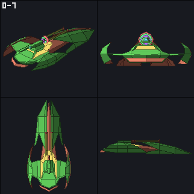
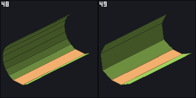
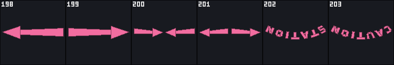
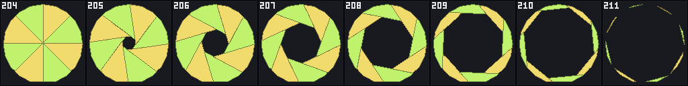
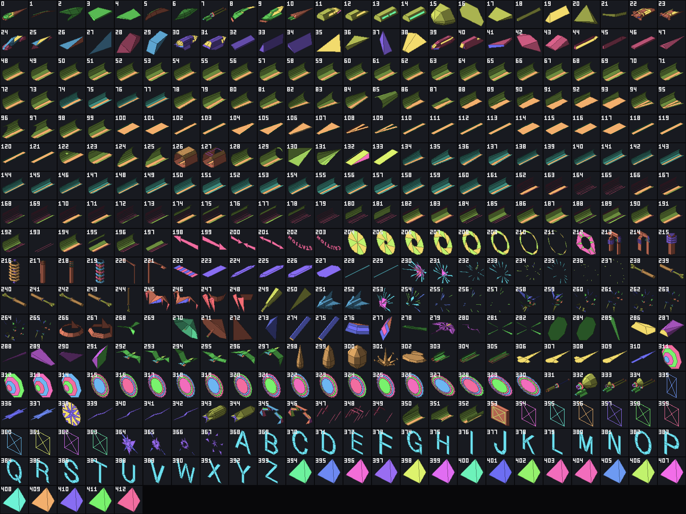

# The object ROMs: format, inventory, and data/objects

**Date**: 2026-11-04 (milestone 3a). What the 384 KB of the six ADSP object ROMs hold, how the
ADSP-2100 reads them and how the 68k chooses what it reads, and how the repository rebuilds them
from `data/objects`. Addresses: ADSP program (PM) and data (DM) words in hex without prefix,
68k addresses as 0x...., object ROM addresses as `page:word` (word = byte offset in
`build/stunrun-obj.bin` / 2 - page × 0x10000). **CODE** means read off the ADSP listing
(`make dasm`, `build/adsp/program.annotated.lst`) or the 68k disassembly at the addresses
given, **MAME** means a MAME 0.289 run with a committed script confirms it, **HYP** is a
hypothesis. MAME source citations are `file:line` in `~/.local/src/mame/src/mame/atari/`.
The SOM display list, the clipper and the GSP side are docs/08 (M3b); this document stops where
the object path hands over to them.

## 1. Summary

- The ADSP reads the object ROMs only as a serial stream: a 64K-word page (/MP), a word
  address (/SIMCLK), and reads that return a word and advance (/SIMBUF). Five places start a
  read sequence (section 2), and a MAME trace of 4.1 million sequences over attract mode and a
  started game matches the decoder's structure: every sequence starts at a structure the
  decoder knows and reads exactly its length (section 7). The trace records no word values;
  those are proven by the byte-identical `make check`. **MAME**
- Page 0 starts with a **directory** of 413 words, one per object, P = page << 14 | address >> 2,
  ended by FFFF. The 68k chooses objects by number through a 24-word **object list entry** per
  object in ADSP data RAM at DM 0A00; a 68k table of 314 **object descriptors** (0x048F9C, 20
  bytes each, 0-313; 313 holds -1/-1) gives each game entity a near and a far object number, cull and level-of-detail
  distances and a radius. **CODE, MAME**
- An **object** is a header (point count, vertex count, normal count), the vertices and the
  normals (three signed words each; the normals are typically of length about 4000h, Q14, an
  observation of the data, section 4), a pointer to the record list, one
  two-word record per face (polygon address; type, count, colour) ended by 0000 0000, and one
  polygon per face (normal point number, vertex point numbers, FFFF). **CODE, MAME**
- Page 1 starts with a 32K-word **reciprocal table** the projection reads (1/z), an exact
  function reproduced by `reciprocal()` in tools/objects. Each page ends with one **checksum
  word** that makes each chip's byte sum equal the last two digits of its part number. **CODE**
  (the table, read at 04C5/04E1), checked over all six chips (the checksum).
- Every one of the 196,608 words is accounted for: 413 objects, the directory, the table, three
  checksum words, zero fill, and **one residue word** (0:019E) the format does not explain.
  `data/objects` (a manifest and 413 mesh files) is now the source of the object image, and
  `make check` rebuilds the six files byte for byte from it (section 8).
- (M3c) Every object has a final name, `tools/objects render` draws them, `tools/objects/viewer.html`
  shows them interactively, and per-level MAME runs from start levels 0-23 (level words 0-24) raise the
  objects seen loaded from 174 to 336 of 413 (section 11).

## 2. How the ADSP drives the object ROMs (CODE, MAME)

The ADSP's I/O at DM 2000-2FFF (`hdadsp_special_r`/`_w`, harddriv_m.cpp:776-838, decoded on
`offset & 7`):

| DM | Access | MAME | Effect |
|---|---|---|---|
| 2000 | read | `/SIMBUF`, :780-784 | returns `sim_memory[eprom_base + sim_address++]`; past the region it returns FF |
| 2001 | write | `/SIMCLK`, :807-809 | `sim_address = data` (a `uint16_t`, harddriv.h:381: it wraps within the page) |
| 2007 | write | `/MP`, :829-831 | `eprom_base = 0x10000 × data` |

`m_sim_memory` is region `mainpcb:user1`, `ROM_REGION16_BE` 0x60000 bytes (harddriv.cpp:2708):
word n is bytes 2n (high) and 2n+1 (low), so the even-byte chips 90h/10h/9h hold the high bytes.
That is the layout of `build/stunrun-obj.bin` (tools/merge-roms).

Every instruction of the program that touches DM 2000, 2001 or 2007:

| PM | Instruction | Role |
|---|---|---|
| 002E | `DM($2007) = AR` | /MP = DM 1FFE once per frame (`select_object_page`); every object overrides it at 00A0/00A6, so it has no effect on the reads below (HYP: a leftover) |
| 009E | `DM($2001) = AR` | /SIMCLK = the object number (sequence **directory**) |
| 00A0 | `DM($2007) = AR` | /MP = 0 |
| 00A3 | `AR = DM($2000)` | the directory word P |
| 00A6 | `DM($2007) = SR1` | /MP = P >> 14 (00A5: `SR = LSHIFT SI BY 2 (LO)`, SR1 holds the bits shifted out) |
| 00A8 | `DM($2001) = SR0` | /SIMCLK = (P << 2) & FFFF (sequence **header**) |
| 011C, 011F, 0123 | `I0 = DM($2000)` | header: point count (overwritten by 011F), vertex count, normal count |
| 0147 | `I0 = $2000` | with M0 = 0 every `DM(I0,M0)` below reads /SIMBUF |
| 014C, 014F, 0152, 0155 | `SI = DM(I0,M0)` (014F in a multifunction) | vertices, one word ahead |
| 0163, 0166, 0172 | `SI = DM(I0,M0)` | normals, one word ahead; the last read is the record-list pointer |
| 017B | `DM($2001) = AY1` | /SIMCLK = record address (sequence **record**) |
| 017F, 0182 | `AX1 = DM($2000)`, `SI = DM($2000)` | record words 0 and 1 |
| 01A7 | `DM($2001) = AX1` | /SIMCLK = polygon address (sequence **polygon**) |
| 01EC, 01FC | `MR0 = DM($2000)` | the face's normal point, its first vertex |
| 01B1 | `MR0 = DM($2000)` | the other vertices and the FFFF (front-facing faces) |
| 01E4 | `MR0 = DM($2000)` | skip to FFFF (faces that look away, colour-0 faces) |
| 04BC | `DM($2007) = AR` | /MP = 1 |
| 04C2 | `DM($2001) = AR` | /SIMCLK = z of a projected vertex (sequence **reciprocal**) |
| 04C5, 04E1 | `MY0 = DM($2000)` | the reciprocal table entry |
| 04DE | `DM($2007) = AR` | /MP = DM 0031, the object's page (saved at 00A7) |

No other instruction addresses DM 2000, 2001 or 2007 directly, and the only index register
loaded with an address in 2000-2007 besides I0 at 0147 is I2 = 2002 at 081C (SOMLATCH, the SOM
output, docs/08). The trace in
section 7 sees no /SIMBUF read outside the five sequences and no /MP write between two reads of
one sequence.

## 3. From the 68k to an object number

### 3.1 The object list entry at DM 0A00 (CODE, MAME)

`copy_frame_parameters` sets DM 001B = 0A00 (0018-0019); `read_object_list` (0050) reads one
24-word entry per object; DM 001B then points at the next one (0085, 0095). Word 0 = FFFF ends
the frame (0051-0053 -> 00B4).

| Word | Read at | To | Meaning | 68k writer (`fill_object_entry` 0x02E1EC; `update` = what `update_object_entry` 0x02E30C rewrites) |
|---:|---|---|---|---|
| 0 | 0051, & 0FFF at 0056-0059 | DM 001C, DM 0009 | near object number | descriptor +0 (0x02E22A; update 0x02E35E) |
| 1 | 005A, & 0FFF | DM 001D | far object number | descriptor +2 (0x02E230; update 0x02E368) |
| 2-10 | 005D-0061 | DM 0000-0008 | the object's rotation matrix | entity +14h, copied by 0x022DD6 (0x02E23E; update 0x02E332) |
| 11-16 | 0062-0066 | DM 001F-0024 | position x, y, z, 32 bits each (high, low) | entity +08h, +0Ch, +10h (0x02E244-0x02E250; update 0x02E33C-0x02E350) |
| 17-18 | 0067-006B | DM 000A-000B | cull distance, 32 bits | descriptor +0Ch (0x02E220; not rewritten by update); an entity with +38h bit 5 set (0x02E1FC) gets 1 if it is the one whose pointer is at 0xFFDC74 (0x02E204-0x02E20E: a cull distance of 1, HYP: then always culled). The camera reading of that entity is contradicted by MAME: in the DUMP_FRAMES=3000 attract dump, entry 0 at DM 0A00 (the 0xFFDC74 entity, 0x02DEFC-0x02DF06) holds objects 130/131, radius 9600, LOD distance 1900h and cull distance 5DC00h, descriptor 83's values, so bit 5 was clear; in that frame the entry was culled (its flags bit 0, DM 0A17, is 0: 0090-0094 write DM 0013 there; DM 0108, cleared at 0038 and counted at 00AF-00B2 after the 0096-0097 cull test, is 1, entry 17's object). A bit-5 entity is otherwise skipped: `fill_object_entry` returns 0 at 0x02E214 and `update_object_entry` returns 0 for any bit-5 entity at 0x02E318-0x02E320 |
| 19-20 | 006C-0070 | DM 0025-0026 | level-of-detail distance, 32 bits | descriptor +08h (0x02E25A; not rewritten by update) |
| 21 | 0071-0073 | DM 000F | bounding radius | descriptor +06h (0x02E264; not rewritten by update) |
| 22 | 0074-0076 | DM 0027, sign into DM 0028 | the object's draw-order bias: `insert_depth_node` adds it to the key of each of the object's commands (07B7-07BB; docs/08 section 1.5) | entity +36h (0x02E26A; update 0x02E3CE) |
| 23 | 007E (not advanced), 0090-0094 | DM 002C, DM 002F | flags: bit 15 -> DM 002C (CALL 0887, HYP: an extra transform); bit 14 -> the batch handshake (0043-004F); bits 8-11 -> DM 002F, ORed into every face's colour word (01CE); bit 0 is written back by the ADSP: 1 = drawn, 0 = culled (DM 0013) | built from entity +38h: bit 7 -> flags bit 15 (0x02E2BE-0x02E2D2), bit 0 -> bit 14 (0x02E28A-0x02E2A2), bits 3-4 -> bits 10-11 (asl #3, lsr #6 at 0x02E274-0x02E276), bits 1-2 -> bits 8-9 (asl #5, lsr #6 at 0x02E2AA-0x02E2AC); bits 12-13 and 1-7 cleared (0x02E2D6-0x02E2F2); bit 0: uninitialised in `fill_object_entry`, whose flags word is the local at (-2,A6) of `link A6,#-$4` (0x02E1EC) and is never set before the `andi.b #$1,(-$1,A6)` at 0x02E2DC (the ADSP overwrites it at 0094); +38h bit 5 is not copied (tested at 0x02E1FC). Update: loads the entry's word (0x02E372), re-merges only bits 10-11 (0x02E37C-0x02E38C), 14 (0x02E390-0x02E3A6) and 8-9 (0x02E3AE-0x02E3BC) from +38h and writes it back (0x02E3C4); it has no `btst #7`, so bits 15, 12-13 and 0-7 stay as last written |

`cull_and_lod` (06A1, called at 0088) culls an entry whose distance from the camera reaches
words 17-18 or that lies outside the view (with the radius), and sets DM 0017 when the distance
reaches words 19-20; 0098-009D then take word 1 instead of word 0. A culled entry never touches
the object ROMs (0096-0097).

`update_object_entry` (0x02E30C-0x02E3DE) is not a full refresh (CODE): it rewrites words 0-16
and 22 and flags bits 8-11 and 14, and leaves words 17-21 (cull distance, LOD distance, radius)
and flags bit 15 as `fill_object_entry` wrote them. An entity whose descriptor (+26h) changes
between two `build_object_list` calls therefore gets the new descriptor's object numbers at the
next refresh but keeps the old descriptor's cull and LOD distances and radius until the list is
rebuilt.

MAME (`tools/mame/dump.lua`, DUMP_FRAMES=3000, attract mode): DM 0A00 holds 18 entries and the
FFFF at DM 0BB0 (0A00 + 18 × 24); words 0/1 are pairs such as 48/49, 60/61, 62/63 (near and far
objects that the descriptors pair, section 6), word 21 = 1131 for the vehicles, word 23 shows
bit 14 (entry 1), bits 8-11 (0100h, 0800h, 0C00h) and bit 0 (entry 17).

The 68k builds the list each frame in `build_object_list` (0x02DD9E): it stores 0x809400 (DM
0A00, `hd68k_adsp_data_w` maps DM n to 0x808000 + 2n) in 0xFF9C6E (0x02DDAE), fills one entry
per entity of its lists (the eight vehicles at 0xFF9C80 + 3Eh × k, 0xFF9E70, the list at
0xFFDA96 and the entity whose pointer is the long at 0xFFDC74, 0x02DF00, filled first, into entry 0 at
0x809400, 0x02DEFC-0x02DF06, and always followed by a 30h step, 0x02DF0C-0x02DF10) through `fill_object_entry`, writes FFFF after the last
(0x02DFB6), calls `soft_reset` if the list passes 15E3h words (0x02DFC6), and starts the frame by
clearing DM 1FFF (0x02DFD4). 0x02E064 refreshes entries (partially, see above) without rebuilding the list: it calls
`update_object_entry` for the 0xFFDC74 entity unconditionally (0x02E180-0x02E186) and, for the
entities of the 0xFFDA96 list (0x02E19E-0x02E1AE) and, through 0x02DFFE (0x02E1BC), the eight
vehicles (0x02E016-0x02E026) and 0xFF9E70 (0x02E03A-0x02E050), only for those whose +38h bit 6
is set, clearing the bit after the call; `build_object_list` clears the same bit after each
fill (0x02DF3E, 0x02DF72, 0x02DFA2). 0x02C85A walks the 0xFFDA96 list only (0x02C86A, end
0xFFDA96 in D4 at 0x02C87C) with each entity's entry index ((+2Ah - 0x809400) / 30h at
0x02C886-0x02C88E; HYP: a debug overlay).

### 3.2 The object descriptors at 0x048F9C (CODE)

`object_descriptor` (0x02ECF0) returns 0x048F9C + 20 × n for n < 13Ah (`cmpi.w #$13a` / `bge`, 0x02ECF8-0x02ECFC: 314 entries, 0-313), else 0. Each
entity holds the pointer at +26h (written at 0x02ECBE and at 20 more sites, 0x031CF0 to 0x040F3A, each right after a `jsr` to `object_descriptor`); 63 call
sites pass a descriptor number. The 20-byte descriptor:

| Offset | Size | Meaning |
|---|---|---|
| +0 | word | near object number (entry word 0) |
| +2 | word | far object number (entry word 1) |
| +4 | word | the descriptor number 0x03DAB8 steps from: it calls `object_descriptor`(+4 + 1) (animations); equal to the descriptor's own number except in 115 and 116, which hold each other's (so 115 steps to 117 and 116 to itself) |
| +6 | word | radius (entry word 21) |
| +8 | long | level-of-detail distance (entry words 19-20) |
| +0Ch | long | cull distance (entry words 17-18) |
| +10h | long | not read by `fill_object_entry` (open question) |

Descriptors 0-312 are populated (whether every one is reached from the 63 call sites is not
established); 313, which `object_descriptor` also accepts, holds -1 as both object numbers and
0 elsewhere (HYP: an end marker; no code that reads it as one was found; were it selected,
entry word 0 = FFFF would end the ADSP's frame at 0051-0053). The table is followed at entry 314
by data that is not a descriptor. **Every object 0-412 is the near or far object of at least
one of descriptors 0-312**, and 100 objects are only ever far objects (marked in
the inventory): `tools/objects inventory --image68k build/stunrun-68k.bin` prints the counts
on stderr, `413 objects: 313 near objects of a descriptor, 100 only far objects, 0 in no
descriptor`. Examples of call sites: descriptors 0-10 (0 by `clr.l -(A7)` at 0x0254F2, the others
by `pea` of a word) are taken at 0x0254A4-0x025610 and 0x02BDBA-0x02BED4 and passed with the
vehicle entities 0xFF9C80 + 3Eh × k (k = 0-7: 9C80, 9CBE, 9CFC, 9D3A, 9D78, 9DB6, 9DF4, 9E32) to
0x02EC9C, and D2h goes with 0xFF9E70 (0x02561A -> 0x025634, 0x02BEDE -> 0x02BEF8), the entity
after them (= 0xFF9C80 + 3Eh × 8) that section 3.1 lists apart from the eight vehicles; descriptor 7Bh + n with n the byte at 0xFFDC86 steps through the iris, objects 205-211: 0x0323DA runs when the byte is 0, makes it 1 (`addq.b` at 0x0323E2) and selects 7Bh + 1 = descriptor 124 (0x0323F0), then 0x031D1E goes on while it is not 0, increments it (0x031D36) and selects 7Bh + n (0x031D68) while n <= 7 (`cmp.l d5,d2` / `bls` at 0x031D40, d5 = 7 from 0x031D00): descriptors 124-130, objects 205-211; 204 (descriptor 123, the closed iris) is selected elsewhere (a linear disassembly of 0x020000-0x05FFFF has no other immediate 7Bh next to a call of 0x02ECF0; M5); 0x0364D4 (A3h -> object 252), 0x03665A and 0x03BFDE (94h -> 230/231), 0x03BE02 (93h
-> 229), 0x033BD2 and 0x0414A8 (C1h -> 292: `pea $c1.w` to 0x02EF4C, which allocates an entity (0x02E810), takes `object_descriptor` of its first argument (0x02EF6C) and binds it by 0x02EC9C; the caller keeps the new entity at +12h), 0x0380EA / 0x03819A (CBh / CAh -> 302 / 301), 0x027B60-0x02842C
(CFh -> 306), 0x025616 / 0x028030 / 0x02BEDA (D2h -> 309). Two routines then animate the entity at +12h through descriptors C1h-C6h, objects 292-297: each reads the +4 word of its current descriptor, adds 1, wraps past C6h to C1h, calls `object_descriptor` and stores the result at +26h, 0x037CF4-0x037D1E (when the tick byte +69h of the parent runs out, `subq.b` / `bne` at 0x037CEC, then reloaded with 5 at 0x037D22) and 0x040F10-0x040F3A (bound C6h in D3 from 0x040C0A, tick byte +66h, reloaded with 2 at 0x040F40; 0x0414B6 sets it to 5 when 0x0414A8 creates the entity). What these entities are in the game is M5's.

### 3.3 The directory (CODE, MAME)

`read_object_pointer` (009E-00A8) sends the object number to /SIMCLK with /MP = 0 and reads one
word P: the object starts at page P >> 14, word (P << 2) & FFFF. Objects therefore start at
multiples of four words, and the directory is page 0 words 0000-019C (413 entries), FFFF at
019D. The ADSP never reads the FFFF (the 68k's descriptors only hold 0-412); it is the
directory's end for the decoder. Within each page the objects lie in number order, each at the
first multiple of 4 after the one before (checked for all 413); `tools/objects` requires
this order in both directions (section 8.1).

## 4. The object (CODE, MAME)

An object at `page:a` (a = 4k), as `read_object_header` (0114) and `read_object_records` (0174)
read it, with nv vertices and nn normals:

| Words | Field | Width | Meaning | Read at |
|---|---|---|---|---|
| a | points | 1 | nv + nn (always, all 413) | 011C into I0, overwritten at 011F: not used |
| a+1 | vertices | 1 | nv, the DO count of the vertex loop | 011F -> DM 0032 (014D) |
| a+2 | normals | 1 | nn, the DO count of the normal loop | 0123 -> DM 08DA (015F) |
| a+3 ... | vertex i (i = 1..nv) | 3 | x, y, z, signed 16 bits, object space | 014C/014F/0152/0155, transformed at 0157-015C into DM 010D + 3(i-1) |
| ... | normal j (j = 1..nn) | 3 | x, y, z, signed; typically of length about 4000h (Q14), see below | 0163/0166/0172, rotated at 0169-0171 into DM 010D + 3(nv + j - 1) |
| a+3+3(nv+nn) | record pointer | 1 | the address of the record list: always the next word | 0172 (the read after the last normal) -> DM 0034 -> /SIMCLK 017B |
| then, per face k | record | 2 | word 0: the face's polygon address; word 1: type << 12, count << 6, colour | 017F, 0182 |
| | end record | 2 | 0000 0000 (type 0) | 017F, 0182, then `RTS` at 0187 |
| then, per face k | polygon | n + 2 | the normal's point number, the n vertices' point numbers, FFFF | 01EC, 01FC, 01B1 (or 01E4) |

then zero padding to the next multiple of 4.

**Normals** are typically of length about 4000h (unit vectors in Q14), which is what the shading
assumes (HYP); nothing in the code depends on it and the encoder does not check it. Over the
5,071 normals (computed from data/objects), 302 differ from 4000h by more than 50 and 10 by more
than 500, every one of them used by a face: the zero normals of objects 310 and 336 (normal 0),
and normals 26-31 and 52-53 of object 333 (lengths 15,446 to 17,854).

**Point numbers.** Vertices and normals share one numbering from 1: vertex i is point i, normal
j is point nv + j. 01EC-01EF turn a point number n into DM 010A + 3n with `MR = MR + MR0 * MY0
(SS)` and MY0 = 1: the ADSP-2100's multiplier works in fractional mode and shifts the product
left by one, so MR0 = n + 2n = 3n. In the ROM every face's first word is a normal point (nv < n
<= nv + nn) and every vertex word a vertex point (1 <= n <= nv), for all 6,540 faces.

**Record word 1** (0182-01A6):

| Bits | Field | Values in the ROM | Consumed |
|---|---|---|---|
| 15-12 | type | 15 (6,527 faces), 1 (13 faces: objects 335 and 353-363) | 0183-0186 `JUMP (I4)` into `record_type_table` (0187): 0 = RTS (end), 1 -> 0197 (DM 0038 = 1), 2-15 -> 0199 |
| 11-6 | count | always 0 | 01A2-01A6: polygons in this record, 0 meaning 1 |
| 5-0 | colour | 0-63 | 019C-01A0 -> DM 0036; 0 skips the face (019F -> 01E4) |

Type 15 faces are shaded: `shade_face` (0214, called at 01C7) turns colours below 1Fh into
(colour << 4) + 10h ORed with an intensity from the normal and two 3-word vectors at PM
1019-101B and 101C-101E (0221-0228: CNTR = 2 at 0222, three multiply-accumulates per pass, I4
from 1019 with M4 = 1 while L3 = 3 wraps I3 over the normal at DM 0014-0016, so the result is
normal . (PM 1019-101B + PM 101C-101E); `copy_frame_parameters` fills all six from DM 1FEF-1FF4
at 001B-0020; HYP: two light vectors), faded with depth by 0238; colours 1Fh and up become colour & 1Fh. Type 1 faces skip shading and
carry 1000h (01C9-01CC), and the clipper takes another path for them (0273-0276 -> 068B, then
0663 at 01D9; docs/08). Every face's colour word then gets the entry's colour bank, flags bits
8-11 (01CD-01D0). What the colour word selects in the GSP palette is docs/08. Type 1 faces are not
polygons: `emit_image` (0663) writes each as a SOM image command whose bits 0-5, the face's
colour, name an image, and the GSP draws it as a scaled image quad (docs/08 sections 1.4 and
4.4); the meshes of objects 335 and 353-363 are the quads' corners.

**A face** (`read_face_normal` 01E8): the normal point goes to DM 0014-0016, the first vertex
to DM 0040-0042; the sign of their dot product in camera space decides visibility (01A9: >= 0
looks away and 01E4 skips to the FFFF). A front-facing face's other vertices are copied to DM
0043 on until the FFFF (01AA-01C1, `copy_polygon_vertices`), and it is handed to the clipper
0271, `project_vertices` 04B2 and the SOM output (01D1-01DB, docs/08). A face has 2 to 16
vertices in the ROM (2 faces have 2: lines).

**Colour 0** hides a face: 019F jumps to 01E4 before /SIMCLK moves to the polygon, so the ADSP
reads on through the record list from the next record until the first FFFF (which is in the
first polygon), then continues with the next record (DM 0035 is still 1 from the previous face).
The polygon of a colour-0 face is never read. 20 faces in 5 objects (87, 179, 193, 195, 197)
have colour 0. **MAME**: the record sequences of these faces read exactly the predicted number
of words (section 7).

**Count above 1 would not work**: 04B2 leaves the address at the last projected vertex's z + 1
(it reads the reciprocal table in page 1 through /SIMCLK at 04C2 and /SIMBUF at 04C5/04E1, then
restores /MP to the object's page at 04DD-04DE, but not /SIMCLK), and 01DF-01E3 jump back to
01A8 with no /SIMCLK write, so a record's second polygon would be read from the object's page at
that address after a front-facing first one. The ROM never uses it, and the encoder rejects it.

**Limits** the encoder checks: three 16-bit coordinates per point, 1 <= vertices <= 3FFFh and
1 <= normals <= 3FFFh (the counts are DO-loop counts loaded into CNTR at 014D and 015F; the
ADSP-2100's counter is 14 bits, so a larger count would be truncated, and a count of 0 does not
skip the loop: MAME runs the body once, 2100ops.hxx `slow_condition` and the `& 0x3fff` of every
CNTR load; HYP for the hardware), types 1-15, colours 0-63, every face with at
least one vertex, object numbers below 1000h (0056: `AND 0FFF`), every object inside its page.
The largest object has 269 points (213), so its transformed points end at DM 010D + 3 × 269 =
0434, below the other DM variables at 08DA up (HYP: the real limit; not probed).

## 5. Everything else in the 384 KB

### 5.1 The reciprocal table, page 1 words 0000-7FFF (CODE)

`project_vertices` (04B2) sets /MP = 1 and /SIMCLK = z for every vertex it projects, and reads
one word: for z > 200h it multiplies x and y by it directly (04C4-04C9), for z <= 200h it shifts
the products left by 9 (04E0-04E9). The table is exactly

    t(z) = int(f32(f32(K / z) + 0.5)),  K = 2^15 for 1 <= z <= 200h, 2^24 for 200h < z < 7FFF
    t(0) = t(7FFF) = 0

where f32 rounds to IEEE single precision: a plain round() differs at five z (2F1h, AC9h, FD3h,
205Bh, 2F79h), whose quotients lie just below n + 0.5 and round up in float32. `reciprocal()` in
tools/objects generates it and the decoder checks all 32,768 words against it, so the table is
not stored in data/objects. **MAME**: every reciprocal read in the traces has page 1 and z in
0064-4E2E.

### 5.2 The checksum words (HYP for their purpose; the rule is checked on all six chips)

After the last object of each page, at the next multiple of 4 (0:F8F8, 1:FF40, 2:4D80), one
word whose high byte makes the byte sum of the page's even chip, and its low byte that of the
odd chip, modulo 256, equal the last two digits of the chip's part number read as hex: 136070-
**2121**.90h sums to 21h, -**2118**.90k to 18h, -**2122**.10h to 22h, -**2119**.10k to 19h,
-**2120**.9h to 20h, -**2117**.9k to 17h. Six chips matching by chance has odds of 256^-6. No
code reads these words (HYP: Atari's ROM checksum convention, checked by a factory tester; the
self-test cannot read the object ROMs except through the ADSP).

### 5.3 The residue word 0:019E

The word after the directory's FFFF, in what would otherwise be the directory's zero padding,
is not zero and nothing reads it: the ADSP reads directory words only at object numbers
0-412, and no structure points at it. Its value interpreted as a directory pointer lands inside
object 30's polygons (on an FFFF), and it matches no count or sum of the directory or the
objects that was tried (sums, XOR, point, face and object counts per page). It stays a residue:
`data/objects/manifest.json` lists its position, never its value, and the generated assembly
takes it from the ROM image with an incbin slice of 2 bytes (`residue_0_019E` in `make
coverage`). Card for Jesus in the M3a report. Because the checksum word of page 0 covers it,
the page-0 chips (90h, 90k) can only be rebuilt with the ROM image present.

### 5.4 The map of all 196,608 words

| Range | Words | What |
|---|---:|---|
| 0:0000-019C | 413 | directory |
| 0:019D | 1 | FFFF, the directory's end |
| 0:019E | 1 | residue (5.3) |
| 0:019F | 1 | zero padding |
| 0:01A0-F8F7 | 62,924 + 396 padding | 221 objects |
| 0:F8F8 | 1 | checksum word |
| 0:F8F9-FFFF | 1,799 | zero |
| 1:0000-7FFF | 32,768 | reciprocal table |
| 1:8000-FF3F | 32,375 + 201 padding | 107 objects |
| 1:FF40 | 1 | checksum word |
| 1:FF41-FFFF | 191 | zero |
| 2:0000-4D7F | 19,651 + 189 padding | 85 objects |
| 2:4D80 | 1 | checksum word |
| 2:4D81-FFFF | 45,695 | zero |

"Padding" is the zero words between objects (and before each page's checksum word) up to the
next multiple of 4. The decoder rebuilds every word from the format alone except the residue
word, and checks that it reproduces the image (`decode()` re-encodes and compares).

## 6. The inventory

413 objects, numbered by their directory index (= entry words 0/1 = descriptor +0/+2). Every
object has a final name in `data/objects/manifest.json` (M3c); section 11.2 gives the naming
convention and the evidence per family, section 10 the table. The objtrace runs of section 7
loaded 174 objects; the per-level runs of section 11.4 loaded 332, together 336; 77 were never
loaded (listed in 11.4). Every one of the 413 is the near or far object of a populated
descriptor.

Columns of the table in section 10: address = word within the page; x, y, z = the vertices'
bounding box (object units); descriptor = the descriptors naming the object as near (n) or far
(nf); run = loaded in the attract (A) or play (P) trace; levels = the level words (0xFF9578) at
which a per-level run loaded it.

## 7. The MAME proof: every object-ROM read (MAME)

`make objtrace` runs `tools/mame/objtrace.lua` twice: attract mode for 3,600 frames, and a game
(coin at frame 900, start at 960, trigger at 1020, as `tools/mame/pcwatch.lua`) for 7,200
frames; snapshots of the second run show the race on screen from frame 2,400 (scratch, not
committed). The script taps DM 2000-2007 of the ADSP's data space (a write tap on the range, a
read tap on 2000; taps observe and do not read the I/O) and cuts the accesses into sequences: a
/SIMCLK write starts one, the /SIMBUF reads until the next /SIMCLK write belong to it. Per
sequence it keeps the PC of the /SIMCLK write, the /MP page at its first read, the start address
and the number of words read, aggregated as "pc page address reads count" in
`build/mame/objtrace-{attract,play}.txt`. It never records a ROM word. The run stops at a frame
boundary, where the ADSP is usually inside a sequence (both runs: `# open_at_end 1`): that last
sequence may be cut short, so the script drops it instead of recording it, and it is not in the
counts below.

Both runs start from the factory state: `make objtrace` gives each its own empty NVRAM and cfg
directories under `build/mame/state-<run>/` (the play run depends on the NVRAM it starts from;
a play run from a copy of the archive NVRAM that `~/.mame/mame.ini` names gave 3,289,155
sequences and 127 objects, also with 0 problems). From that state the trace is deterministic: two consecutive `make
objtrace` runs wrote the same summary. The numbers below assume an empty NVRAM.

`tools/test_objects.py::test_mame_trace_matches_decoder` (skips without the traces) asserts,
for both runs, that every sequence starts where the decoder has a structure of the kind its PC
reads and reads exactly as many words as the decoder says:

| PC | Kind | Must start at | Words |
|---|---|---|---|
| 009E | directory | page 0, an object number 0-412 | 1 |
| 00A8 | header | an object's first word | 4 + 3 (vertices + normals) |
| 017B | record | a record of that object (the end record included) | 2; for a colour-0 face 2 + the words up to and including the next FFFF |
| 01A7 | polygon | the polygon of a face with colour > 0 | vertices + 2 |
| 04C2 | reciprocal | page 1, z in 0001-7FFE | 1 |

and that no /MP write falls between two reads of one sequence and no read precedes the first
/SIMCLK write. Result (`tools/objects trace --summary artifacts/objtrace-summary.json`, the last step of `make objtrace`):

| Run | Frames | Sequences | Directory | Header | Record | Polygon | Reciprocal | Objects loaded |
|---|---:|---:|---:|---:|---:|---:|---:|---:|
| attract | 3,600 | 1,036,283 | 13,914 | 13,914 | 238,982 | 225,070 | 544,403 | 137 |
| play | 7,200 | 3,113,316 | 45,086 | 45,086 | 728,772 | 683,506 | 1,610,866 | 115 |

**0 problems**: every one of the 4,149,599 sequences starts at a structure the decoder knows
and reads exactly its length (the trace holds no word values; `make check` proves those), over 3,289 distinct
record starts and 3,109 distinct polygon starts, the colour-0 faces of object 87 included (the
other colour-0 objects, 179, 193, 195 and 197, were not loaded); reciprocal reads use z
0064-4E2E. 174 objects were loaded, 239 never (they are in
the summary's `objects_never_loaded`). The test fails on a planted difference:
`test_trace_check_catches_planted_problems` feeds the checker a sequence one word too long, one
at a non-structure, a reciprocal read at z = 0 and an orphan read, and gets four problems.

## 8. data/objects, the tools and the build

### 8.1 The mesh files

`data/objects/NNN.json`, one per object, integers exactly as in the ROM:

```
{
  "object": 3,
  "vertices": [ [x, y, z], ... ],        signed 16-bit, object space
  "normals": [ [x, y, z], ... ],         signed 16-bit, typically of length about 4000h
  "faces": [
    {"type": 15, "colour": 7, "normal": 0, "vertices": [5, 4, 0, 1]}, ...
  ]
}
```

Indices are 0-based into `vertices` and `normals`; faces are in ROM order (record order = polygon
order). Everything else is derived when encoding: the point count, the point numbers (vertex
i + 1, normal nv + j + 1), the record-list pointer, the polygon addresses, the end record, the
FFFF terminators, the padding, the directory, the reciprocal table and the checksum words.

`data/objects/manifest.json` holds the format name, the object count, per page the chips and the
object numbers in ascending number order, which is also the address order (the placement:
each page packs its objects in that order at the first multiple of 4 after the page's fixed
part), the reciprocal table's rule, the residue ranges (position and length, never values) and
the object names (section 11.2; the encoder does not read them). A person edits a vertex, a colour or a face in a mesh file, or moves an
object to another page in the manifest by inserting its number at its sorted place in that
page's list; the encoder re-places everything. The encoder rejects a page list that is not in
ascending number order (`page N: objects must be in number order`), and the decoder rejects an
image whose pages are not (section 3.3). The ADSP itself would not need the order (the
directory holds each object's address); the rule keeps encode and decode inverse to each other
and matches all three pages of the ROM.

### 8.2 tools/objects

`tools/objects/__init__.py` is the format (decoder, encoder, generated assembly, the trace
check); `tools/objects` the CLI:

| Command | What |
|---|---|
| `decode` (`make objects`) | reads `build/stunrun-obj.bin` the way the ADSP does and writes data/objects; keeps the names of the existing manifest (read from the manifest alone, so an invalid mesh file does not lose them) and refuses to overwrite a manifest that does not parse; fails where the image is not the format |
| `asm` (`make`) | writes `build/obj/page0.asm`-`page2.asm` from data/objects |
| `encode` | writes the image itself (tests, experiments) |
| `inventory` | prints the table of section 10 |
| `trace` | checks the traces against the decoder; with `--summary FILE` (as `make objtrace` runs it) also writes their summary, `artifacts/objtrace-summary.json` |
| `levels` | summarises the per-level runs (section 11.4) into `artifacts/objlevels-summary.json` |
| `render` | draws objects to a PNG (section 11.1) |
| `pictures` (`make pictures`) | rewrites the pictures of section 11.3 |

The decoder is strict: a header count that is not vertices + normals, a record list that does
not follow the header, polygons out of record order, a count field, a face normal that is not a
normal point, a vertex that is not a vertex point, an object out of the packed layout, a page 1
that is not the reciprocal table, or a re-encoding that differs are errors. Non-zero words where
the format predicts zero padding become residue ranges.

### 8.3 The build

`asm/obj/objects.asm` includes the three generated page sources, with an assert at each page
boundary and at the end (60000h); each generated source has a label and an assert at every
structure (`object_NNN`, `object_directory`, `reciprocal_table`, `checksum_pageN`), `dc.w` for
every decoded word, `dcb.w n,0` for every zero run, and `incbin "../../build/stunrun-obj.bin"`
for the residue word. The page sources depend on data/objects, the tools and the image (which
supplies the residue word and, through it, page 0's checksum word). `make check`: 25 files,
0 differences.

`make coverage` counts the object image as `data` (296,270 bytes) and `fill` (96,944 bytes) under
the generated sources `../../build/obj/page{0,1,2}.asm`, and 2 bytes of blob (`residue_0_019E`):
the blob share of the set falls from 100.0% to 74.0%.

`make test` (tools/test_objects.py): synthetic objects through encode and decode on random
layouts, planted differences (one vertex word changes exactly that word and its page's checksum
word), residue handling, malformed images and mesh files rejected, the generated assembly
assembled by vasm equal to `encode()`; in CI, the committed data/objects encodes to the four
chips of pages 1 and 2 with the CRC-32 and SHA-1 MAME lists; with the reference set, decode
reproduces data/objects file for file and encode reproduces the image; with the traces, section
7. `tools/test_build.py` keeps `make all` on a synthetic set meaningful: the synthetic set
carries the object image the committed data encodes to (with a random residue word), `make all`
must rebuild it, and an edited mesh in the copy (object 100, first vertex x) must change exactly
two bytes of chip 90k, at the vertex's x word and page 0's checksum word, and nothing else in the
25 files (the test first undoes its planted 68k byte, then compares every built file).

## 9. Open questions

1. The residue word 0:019E (section 5.3): what wrote it? Card for Jesus.
2. Descriptor +10h (a long, 6000A0h for many) is not read by `fill_object_entry`; who reads it?
3. Entry word 22 (entity +36h) reaches DM 0027-0028; its reader: answered by docs/08 section 1.5
   (07B7-07BB add it to every command's draw-order key: the object's depth bias).
4. Flags bit 15 and routine 0887 (an extra transform of the position, HYP).
5. Which game entity each descriptor is: M5 (the call sites of section 3.2 are the entry points).
6. Type 1 faces (objects 335, 353-363): what the 068B/0663 path does with them: answered by
   docs/08 sections 1.4 and 4.4 (SOM image commands, drawn by the GSP as scaled image quads;
   068B drops one whose corner is too near, HYP: a near-plane cull).
7. The 77 objects no run loaded (section 11.4): steered play (the runs never steer), the
   self-test, or none (unused objects).
8. Objects 202 and 203 (`sign_station`, `sign_caution`) are stored upside down and the game
   places them with a matrix whose middle element is -4000h (section 11.1, MAME): which 68k
   call site builds that matrix is M5's.

## 10. Inventory table

Generated by `uv run --frozen python tools/objects inventory --image68k build/stunrun-68k.bin
--summary artifacts/objtrace-summary.json --levels artifacts/objlevels-summary.json` (the
descriptor column from the table at 0x048F9C, section 3.2: "d" = near object of descriptor d,
"df" = only its far object; the run column from the objtrace summary, section 7; the levels
column from the per-level runs, section 11.4: the level words at which a run loaded the object;
the names from data/objects/manifest.json, section 11.2). `tools/test_objects.py` checks that
this table is the command's output (with the reference set) and `tools/test_render.py` that its
name column is the manifest's (everywhere).

| # | page | address | vertices | normals | faces | x | y | z | descriptor | run | levels | name |
|---:|---:|---|---:|---:|---:|---|---|---|---|---|---|---|
| 0 | 0 | 01A0 | 49 | 38 | 38 | -71..70 | 10..60 | -271..276 | 0 | AP | 0-24 | player_craft_body |
| 1 | 0 | 03D4 | 12 | 16 | 20 | -87..-13 | 0..78 | -19..288 | 1 | AP | 1-24 | player_craft_fin_left |
| 2 | 0 | 04C4 | 12 | 16 | 20 | 12..86 | 0..78 | -19..288 | 2 | AP | 1-24 | player_craft_fin_right |
| 3 | 0 | 05B4 | 6 | 5 | 5 | -133..-69 | 28..34 | -189..-83 | 3 | AP | 1-24 | player_craft_wing_left |
| 4 | 0 | 0604 | 6 | 5 | 5 | 68..132 | 28..34 | -189..-83 | 4 | AP | 1-24 | player_craft_wing_right |
| 5 | 0 | 0654 | 18 | 18 | 18 | -133..-95 | 6..68 | -255..16 | 5 | AP | 1-24 | player_craft_pod_left |
| 6 | 0 | 0754 | 18 | 18 | 18 | 94..132 | 6..68 | -255..16 | 6 | AP | 1-24 | player_craft_pod_right |
| 7 | 0 | 0854 | 122 | 26 | 46 | -27..26 | 54..98 | -161..92 | 7 | AP | 1-24 | player_craft_guns |
| 8 | 2 | 0000 | 32 | 20 | 20 | -71..0 | 10..60 | -271..-19 | 8 | P | 0,22 | player_craft_rear_left |
| 9 | 2 | 0140 | 32 | 20 | 20 | 0..70 | 10..60 | -271..-19 | 9 | P | 0,22 | player_craft_rear_right |
| 10 | 2 | 0280 | 32 | 17 | 21 | -49..48 | 10..50 | -157..276 | 10 | P | 0,22 | player_craft_front |
| 11 | 0 | 0B90 | 54 | 29 | 30 | -251..250 | 0..274 | -563..562 | 11 | AP | 1-3,8,10-11,16,19,21-22 | box_windowed_a |
| 12 | 0 | 0D80 | 20 | 8 | 8 | -251..250 | 0..274 | -563..562 | 11f | AP | 1-3,8,10-11,16,19,21-22 | box_windowed_a_far |
| 13 | 0 | 0E1C | 32 | 10 | 12 | -251..250 | 0..274 | -563..562 | 12 | AP | 1-3,8,10,19,21-22 | box_windowed_b |
| 14 | 0 | 0F04 | 20 | 8 | 8 | -251..250 | 0..274 | -563..562 | 12f | AP | 1-3,8,10,19,21-22 | box_windowed_b_far |
| 15 | 0 | 0FA0 | 19 | 14 | 14 | -251..250 | 0..274 | -837..-563 | 13 | AP | 1-3,8,10-11,16,19,21-22 | block_rounded |
| 16 | 0 | 1078 | 6 | 1 | 1 | -251..250 | 0..274 | -563..-563 | 13f | AP | 1,3,8,10-11,16,19,21-22 | block_rounded_far |
| 17 | 0 | 10A0 | 6 | 5 | 5 | -125..124 | -21..18 | -93..84 | 14 | A | 1-2,8,10-11,19,21-22 | prism_a |
| 18 | 0 | 10F0 | 6 | 5 | 5 | -21..26 | -21..22 | -289..308 | 15 | A | 1-2,8,10-11,19,21-22 | rod_a |
| 19 | 0 | 1140 | 6 | 5 | 5 | -41..26 | -37..36 | -167..130 | 16 | A | 1-2,8,10-11,19,21-22 | prism_b |
| 20 | 0 | 1190 | 4 | 4 | 4 | -71..86 | -71..90 | -63..60 | 17 | A | 1-2,8,10-11,19,21-22 | tetrahedron_large |
| 21 | 0 | 11CC | 17 | 7 | 8 | -139..110 | -25..24 | -145..136 | 18 | A | 1-2,8,10-11,19,21-22 | strip_bent |
| 22 | 0 | 1258 | 76 | 63 | 70 | -269..268 | 0..180 | -445..544 | 19 | AP | 2-3,5,7-22 | craft_a |
| 23 | 0 | 1618 | 55 | 28 | 37 | -281..280 | 0..180 | -461..576 | 19f | - | 2-3,5,7-20,22 | craft_a_far |
| 24 | 0 | 1838 | 39 | 33 | 33 | -103..102 | 0..204 | -451..410 | 20 | A | 2-3,5-22 | craft_b |
| 25 | 0 | 1A18 | 12 | 10 | 10 | -91..90 | 0..156 | -405..390 | 20f | - | 2-3,5-16,18-20,22 | craft_b_far |
| 26 | 0 | 1AA8 | 4 | 4 | 4 | -37..36 | -27..14 | -109..68 | 21 | A | 2-3,5-7,9-10,12-22 | tetrahedron_a |
| 27 | 0 | 1AE4 | 4 | 4 | 4 | -37..42 | -31..62 | -127..84 | 22 | A | 2-3,5-7,9-10,12-22 | tetrahedron_b |
| 28 | 0 | 1B20 | 8 | 6 | 6 | -21..46 | -41..60 | -123..104 | 23 | A | 2-3,5-7,9-10,12-22 | box_skewed |
| 29 | 0 | 1B80 | 6 | 5 | 5 | -37..36 | -59..42 | -51..78 | 24 | A | 2-3,5-7,9-10,12-22 | prism_c |
| 30 | 0 | 1BD0 | 67 | 58 | 59 | -361..360 | 0..312 | -665..666 | 25 | A | 5-22 | craft_c |
| 31 | 0 | 1F10 | 30 | 22 | 22 | -363..362 | 0..312 | -665..666 | 25f | A | 5-22 | craft_c_far |
| 32 | 0 | 205C | 6 | 5 | 5 | -71..62 | -31..24 | -249..252 | 26 | A | 5-16,18-22 | slab_a |
| 33 | 0 | 20AC | 6 | 5 | 5 | -71..30 | -67..66 | -223..278 | 27 | A | 5-16,18-22 | prism_d |
| 34 | 0 | 20FC | 6 | 5 | 5 | -55..66 | -41..56 | -195..230 | 28 | A | 5-16,18-22 | prism_e |
| 35 | 0 | 214C | 4 | 4 | 4 | -61..48 | -35..58 | -75..54 | 29 | A | 5-16,18-22 | tetrahedron_c |
| 36 | 0 | 2188 | 4 | 4 | 4 | -45..76 | -89..20 | -73..60 | 30 | A | 5-16,18-22 | tetrahedron_d |
| 37 | 0 | 21C4 | 4 | 4 | 4 | -101..130 | -45..48 | -113..68 | 31 | A | 5-16,18-22 | tetrahedron_e |
| 38 | 0 | 2200 | 10 | 5 | 5 | -141..140 | -83..76 | -91..100 | 32 | A | 5-16,18-22 | prism_f |
| 39 | 0 | 225C | 54 | 52 | 52 | -281..280 | 0..320 | -869..864 | 33 | A | 6-16,18-22 | craft_d |
| 40 | 0 | 2534 | 35 | 15 | 16 | -217..216 | 0..300 | -639..694 | 33f | A | 6-16,18-22 | craft_d_far |
| 41 | 0 | 2650 | 10 | 5 | 5 | -53..132 | -19..34 | -195..282 | 34 | A | 6-16,18-22 | slab_b |
| 42 | 0 | 26AC | 7 | 7 | 7 | -139..138 | -49..68 | -59..38 | 35 | A | 6-16,18-22 | block_faceted |
| 43 | 0 | 2710 | 8 | 7 | 7 | -133..132 | -37..52 | -109..132 | 36 | A | 6-16,18-22 | wedge_a |
| 44 | 0 | 277C | 27 | 8 | 9 | -33..16 | -27..42 | -231..302 | 37 | A | 6-16,18-22 | rod_b |
| 45 | 0 | 2834 | 10 | 8 | 9 | -51..46 | -53..84 | -461..604 | 38 | A | 6-16,18-22 | rod_c |
| 46 | 0 | 28B8 | 8 | 6 | 6 | -81..80 | -21..20 | -461..360 | 39 | A | 6-16,18-22 | slab_c |
| 47 | 0 | 2918 | 4 | 4 | 4 | -81..80 | -21..20 | -239..238 | 40 | A | 6-16,18-22 | tetrahedron_f |
| 48 | 0 | 2954 | 38 | 19 | 19 | -1600..1600 | -1561..1561 | -3200..3200 | 41 | AP | 0-23 | tunnel_straight |
| 49 | 0 | 2AA0 | 18 | 9 | 9 | -1647..1647 | -1561..1728 | -3200..3200 | 41f | AP | 0-23 | tunnel_straight_far |
| 50 | 0 | 2B40 | 38 | 19 | 19 | -1600..1600 | -1561..1561 | -3304..3304 | 42 | AP | 0-22 | tunnel_bend_xp7 |
| 51 | 0 | 2C8C | 18 | 9 | 9 | -1647..1647 | -1561..1728 | -3307..3307 | 42f | AP | 0-22 | tunnel_bend_xp7_far |
| 52 | 0 | 2D2C | 38 | 19 | 19 | -1600..1600 | -1561..1561 | -3304..3304 | 43 | AP | 0-5,9-16,18-19,22 | tunnel_bend_xn7 |
| 53 | 0 | 2E78 | 18 | 9 | 9 | -1647..1647 | -1561..1728 | -3415..3200 | 43f | AP | 0-5,7,9-16,18-19,22 | tunnel_bend_xn7_far |
| 54 | 0 | 2F18 | 38 | 19 | 19 | -1600..1600 | -1560..1561 | -3241..3186 | 44 | - | - | tunnel_bend_yp1 |
| 55 | 0 | 3064 | 18 | 9 | 9 | -1647..1647 | -1561..1728 | -3214..3214 | 44f | - | - | tunnel_bend_yp1_far |
| 56 | 0 | 3104 | 38 | 19 | 19 | -1600..1600 | -1552..1570 | -3404..3132 | 45 | AP | 0,3-5,7-10,12,15-22 | tunnel_bend_yp5 |
| 57 | 0 | 3250 | 18 | 9 | 9 | -1647..1647 | -1561..1728 | -3272..3272 | 45f | AP | 0,3-5,7-10,12,15-22 | tunnel_bend_yp5_far |
| 58 | 0 | 32F0 | 38 | 19 | 19 | -1600..1600 | -1561..1560 | -3241..3186 | 46 | - | - | tunnel_bend_yn1 |
| 59 | 0 | 343C | 18 | 9 | 9 | -1647..1647 | -1561..1728 | -3214..3214 | 46f | - | - | tunnel_bend_yn1_far |
| 60 | 0 | 34DC | 38 | 19 | 19 | -1600..1600 | -1570..1552 | -3404..3132 | 47 | AP | 0,3-5,7-10,12,16-22 | tunnel_bend_yn5 |
| 61 | 0 | 3628 | 18 | 9 | 9 | -1647..1647 | -1561..1728 | -3272..3272 | 47f | AP | 0,3-5,7-10,12,16-22 | tunnel_bend_yn5_far |
| 62 | 0 | 36C8 | 38 | 19 | 19 | -1600..1600 | -1561..1561 | -3323..3323 | 48 | A | 3,9,17 | tunnel_bend_xp7_yn5 |
| 63 | 0 | 3814 | 18 | 9 | 9 | -1647..1647 | -1561..1728 | -3323..3323 | 48f | A | 3,9,17 | tunnel_bend_xp7_yn5_far |
| 64 | 0 | 38B4 | 38 | 19 | 19 | -1600..1600 | -1561..1561 | -3323..3323 | 49 | - | 9 | tunnel_bend_xn7_yn5 |
| 65 | 0 | 3A00 | 18 | 9 | 9 | -1647..1647 | -1561..1728 | -3323..3323 | 49f | - | 9 | tunnel_bend_xn7_yn5_far |
| 66 | 0 | 3AA0 | 38 | 19 | 19 | -1600..1600 | -1561..1561 | -3327..3327 | 50 | - | 9,16-17 | tunnel_bend_xp7_yp5 |
| 67 | 0 | 3BEC | 18 | 9 | 9 | -1647..1647 | -1561..1728 | -3345..3345 | 50f | - | 9,16-17 | tunnel_bend_xp7_yp5_far |
| 68 | 0 | 3C8C | 38 | 19 | 19 | -1600..1600 | -1561..1561 | -3327..3327 | 51 | A | 3,7,16,18,21 | tunnel_bend_xn7_yp5 |
| 69 | 0 | 3DD8 | 18 | 9 | 9 | -1647..1647 | -1561..1728 | -3345..3345 | 51f | A | 3,7,16,18,21 | tunnel_bend_xn7_yp5_far |
| 70 | 0 | 3E78 | 38 | 19 | 19 | -1600..1600 | -1561..1561 | -3307..3307 | 52 | - | 16-17 | tunnel_bend_xp7_yn2 |
| 71 | 0 | 3FC4 | 18 | 9 | 9 | -1647..1647 | -1561..1728 | -3309..3309 | 52f | - | 16-17 | tunnel_bend_xp7_yn2_far |
| 72 | 0 | 4064 | 38 | 19 | 19 | -1600..1600 | -1561..1561 | -3307..3307 | 53 | - | 16-17 | tunnel_bend_xn7_yn2 |
| 73 | 0 | 41B0 | 18 | 9 | 9 | -1647..1647 | -1561..1728 | -3417..3200 | 53f | - | 16-17 | tunnel_bend_xn7_yn2_far |
| 74 | 0 | 4250 | 38 | 19 | 19 | -1200..1200 | -1170..1170 | -3200..3200 | 54 | - | 2,4,10,14-15,17,21 | tunnel_r1200_straight |
| 75 | 0 | 439C | 18 | 9 | 9 | -1235..1235 | -1233..1233 | -3200..3200 | 54f | - | 2,4,10,14-15,17,21 | tunnel_r1200_straight_far |
| 76 | 0 | 443C | 38 | 19 | 19 | -800..800 | -780..780 | -3200..3200 | 55 | - | 4,9-10,17,20-22 | tunnel_r800_straight |
| 77 | 0 | 4588 | 18 | 9 | 9 | -823..823 | -781..864 | -6400..0 | 55f | - | 4,9-11,17,20-22 | tunnel_r800_straight_far |
| 78 | 0 | 4628 | 38 | 19 | 19 | -1600..1600 | -1561..1561 | -3200..3200 | 56 | - | 2,4,9-10,14-15,17,20-22 | tunnel_taper_1600_1200 |
| 79 | 0 | 4774 | 18 | 9 | 9 | -1647..1647 | -1561..1728 | -3200..3200 | 56f | - | 2,4,9-11,13-15,17,20-22 | tunnel_taper_1600_1200_far |
| 80 | 0 | 4814 | 38 | 19 | 19 | -1600..1600 | -1561..1561 | -3200..3200 | 57 | - | 2,4,9-10,14-15,17,20-22 | tunnel_taper_1200_1600 |
| 81 | 0 | 4960 | 18 | 9 | 9 | -1647..1647 | -1561..1728 | -3200..3200 | 57f | - | 2,4,9-10,14-15,17,20-22 | tunnel_taper_1200_1600_far |
| 82 | 0 | 4A00 | 38 | 19 | 19 | -1600..1600 | -1561..1561 | -3200..3200 | 58 | - | - | tunnel_taper_800_1600 |
| 83 | 0 | 4B4C | 18 | 9 | 9 | -1647..1647 | -1561..1728 | -3200..3200 | 58f | - | - | tunnel_taper_800_1600_far |
| 84 | 0 | 4BEC | 38 | 19 | 19 | -1600..1600 | -1561..1561 | -3200..3200 | 59 | - | - | tunnel_taper_1600_800 |
| 85 | 0 | 4D38 | 18 | 9 | 9 | -1647..1647 | -1561..1728 | -3200..3200 | 59f | - | - | tunnel_taper_1600_800_far |
| 86 | 1 | 8000 | 38 | 23 | 23 | -1600..1600 | -1561..1561 | -3200..3200 | 60 | P | 0-2,4-5,9,11-12,23 | tunnel_transition_1 |
| 87 | 1 | 8170 | 18 | 11 | 11 | -1647..1647 | -1561..1728 | -3200..3200 | 60f | P | 0-2,4-5,9-12,23 | tunnel_transition_1_far |
| 88 | 1 | 8224 | 36 | 22 | 22 | -1600..1600 | -1562..1483 | -3204..3196 | 61 | P | 0-2,4-5,9,11,23 | tunnel_transition_2 |
| 89 | 1 | 837C | 18 | 12 | 12 | -1647..1647 | -1561..1728 | -3202..3200 | 61f | P | 0-2,4-5,9,11-12,23 | tunnel_transition_2_far |
| 90 | 1 | 8438 | 24 | 18 | 18 | -1600..1600 | -1560..980 | -3201..3201 | 62 | P | 0-2,4-5,9,11,23 | tunnel_transition_3 |
| 91 | 1 | 8540 | 15 | 8 | 8 | -1647..1647 | -1561..976 | -3202..3200 | 62f | P | 0-2,4-5,9,11-12,23 | tunnel_transition_3_far |
| 92 | 1 | 85CC | 15 | 12 | 12 | -1600..1600 | -1562..464 | -3200..3200 | 63 | P | 0-2,4-5,9,11,23 | tunnel_transition_4 |
| 93 | 1 | 867C | 10 | 8 | 8 | -1647..1647 | -1560..466 | -3200..3201 | 63f | P | 0-2,4-5,9,11-12,23 | tunnel_transition_4_far |
| 94 | 1 | 86F4 | 52 | 27 | 27 | -1599..3194 | -1567..1567 | -3409..3236 | 64 | AP | 7-8,10-11,13,17-18,21 | tunnel_fork |
| 95 | 1 | 88B8 | 24 | 15 | 15 | -1713..3140 | -1557..1724 | -3408..3193 | 64f | AP | 7-8,10-11,13,17-18,21 | tunnel_fork_far |
| 96 | 1 | 89A8 | 40 | 19 | 19 | -1600..1600 | -1561..1561 | -3254..3254 | 65 | AP | 7-8,10-11,13,17-18,21 | tunnel_bend_sharp_xn27_yn2 |
| 97 | 1 | 8AFC | 20 | 9 | 9 | -1659..1643 | -1569..1736 | -3523..3005 | 65f | AP | 7-8,10-11,13,17-18,21 | tunnel_bend_sharp_xn27_yn2_far |
| 98 | 1 | 8BA4 | 40 | 19 | 19 | -1600..1600 | -1561..1561 | -3254..3254 | 66 | AP | 7-8,10-11,13,17-18,21 | tunnel_bend_sharp_xp27_yn2 |
| 99 | 1 | 8CF8 | 20 | 9 | 9 | -1633..1661 | -1561..1728 | -3519..3014 | 66f | AP | 7-8,10-11,13,17-18,21 | tunnel_bend_sharp_xp27_yn2_far |
| 100 | 0 | 4DD8 | 28 | 5 | 15 | -1632..1632 | -1561..-1401 | -3200..3200 | 67 | AP | 0-24 | track_wide |
| 101 | 0 | 4EBC | 8 | 3 | 5 | -1600..1600 | -1561..-1433 | -3200..3200 | 67f | AP | 0-24 | track_wide_far |
| 102 | 0 | 4F0C | 28 | 5 | 11 | -526..526 | -1561..-1401 | -3200..3200 | 68 | AP | 1-22 | track_narrow |
| 103 | 0 | 4FD0 | 8 | 3 | 5 | -494..494 | -1561..-1433 | -3200..3200 | 68f | AP | 1-22 | track_narrow_far |
| 104 | 0 | 5020 | 28 | 8 | 11 | -1632..1632 | -1561..-1401 | -3200..3200 | 69 | AP | 0-22 | track_narrowing |
| 105 | 0 | 50EC | 8 | 5 | 5 | -1600..1600 | -1561..-1433 | -3200..3200 | 69f | AP | 0-1,3-4,6-9,11-16,18-21 | track_narrowing_far |
| 106 | 0 | 5144 | 28 | 8 | 11 | -1632..1632 | -1561..-1401 | -3200..3200 | 70 | AP | 0-1,3-4,6-9,11-21 | track_widening |
| 107 | 0 | 5210 | 8 | 5 | 5 | -1600..1600 | -1561..-1433 | -3200..3200 | 70f | AP | 0-1,3-4,6-9,11-21 | track_widening_far |
| 108 | 1 | 8DA0 | 48 | 19 | 33 | -526..2158 | -1561..48 | -3224..3312 | 71 | - | - | track_fork |
| 109 | 1 | 8F74 | 19 | 11 | 14 | -495..2127 | -1561..48 | -3223..3312 | 71f | - | - | track_fork_far |
| 110 | 1 | 9044 | 28 | 9 | 14 | -526..526 | -1561..-1401 | -3254..3214 | 72 | - | - | track_narrow_bend_1 |
| 111 | 1 | 912C | 8 | 5 | 7 | -494..494 | -1561..-1433 | -3254..3210 | 72f | - | - | track_narrow_bend_1_far |
| 112 | 1 | 9194 | 30 | 9 | 20 | -526..526 | -1561..-1401 | -3255..3214 | 73 | - | - | track_narrow_bend_2 |
| 113 | 1 | 92B0 | 10 | 5 | 11 | -494..494 | -1561..-1433 | -3255..3210 | 73f | - | - | track_narrow_bend_2_far |
| 114 | 0 | 5268 | 12 | 5 | 7 | -1632..1632 | -1561..-1401 | -3413..3200 | 74 | P | 0-1,3-4,6-9,12-15,18-19 | track_wide_bend_1 |
| 115 | 0 | 52DC | 8 | 3 | 5 | -1600..1600 | -1561..-1433 | -3409..3200 | 74f | P | 0-1,3-4,6-9,12-15,18-19 | track_wide_bend_1_far |
| 116 | 0 | 532C | 12 | 5 | 7 | -1632..1632 | -1561..-1401 | -3413..3200 | 75 | P | 0-1,3-4,6-9,13-15,18,20-21 | track_wide_bend_2 |
| 117 | 0 | 53A0 | 8 | 3 | 5 | -1600..1600 | -1561..-1433 | -3409..3200 | 75f | P | 0-1,3-4,6-9,13-15,18,20-21 | track_wide_bend_2_far |
| 118 | 0 | 53F0 | 28 | 9 | 14 | -526..526 | -1561..-1401 | -3214..3254 | 76 | - | 6,8,10,13,15-16,18-20,22 | track_narrow_bend_3 |
| 119 | 0 | 54D8 | 8 | 5 | 7 | -494..494 | -1561..-1433 | -3210..3254 | 76f | - | 6,8,10,13,15-16,18-20,22 | track_narrow_bend_3_far |
| 120 | 0 | 5540 | 30 | 9 | 19 | -526..526 | -1561..-1401 | -3214..3255 | 77 | - | 6,8,10,13,15-16,18,21-22 | track_narrow_bend_4 |
| 121 | 0 | 5654 | 10 | 5 | 11 | -494..494 | -1561..-1433 | -3210..3255 | 77f | - | 6,8,10,13,15-16,18,21-22 | track_narrow_bend_4_far |
| 122 | 1 | 933C | 57 | 37 | 37 | -1600..1600 | -1561..1561 | -3200..3200 | 78 | AP | 0-1,3-4,6-22 | tunnel_mouth_a |
| 123 | 1 | 9584 | 18 | 9 | 9 | -1647..1647 | -1561..1728 | -3200..3200 | 78f | AP | 0-1,3-4,6-22 | tunnel_mouth_a_far |
| 124 | 1 | 9624 | 57 | 37 | 37 | -1681..1681 | -1640..1640 | -3357..3200 | 79 | AP | 0-1,3-4,7,9-14,16,18-20 | tunnel_mouth_flared |
| 125 | 1 | 986C | 18 | 9 | 9 | -1647..1647 | -1561..1728 | -3200..3200 | 79f | AP | 0-1,3-4,7,9-14,16,18-21 | tunnel_mouth_flared_far |
| 126 | 0 | 56E0 | 152 | 22 | 64 | -3200..3200 | -2560..2560 | -3200..3200 | 80 | P | 0 | tunnel_square_a |
| 127 | 0 | 5AE8 | 157 | 21 | 60 | -3200..3200 | -2560..2560 | -3200..3200 | 81 | - | - | tunnel_square_b |
| 128 | 0 | 5EE4 | 43 | 27 | 27 | -1600..1600 | -1561..1873 | -3200..3203 | 82 | AP | 0-23 | tunnel_roof_raised |
| 129 | 0 | 6090 | 23 | 12 | 13 | -1647..1647 | -1561..2041 | -3200..3200 | 82f | AP | 0-23 | tunnel_roof_raised_far |
| 130 | 1 | 990C | 5 | 4 | 4 | -1760..1760 | -1760..1760 | 0..6400 | 83 | - | - | pyramid_large |
| 131 | 1 | 994C | 10 | 9 | 9 | -1647..1647 | -1561..1728 | 0..6400 | 83f | AP | 0-23 | pyramid_large_far |
| 132 | 0 | 6168 | 22 | 9 | 9 | -800..800 | 0..659 | -1611..1575 | 84 | A | 3,6-7,10,12-16,18-19,21-22 | ramp |
| 133 | 0 | 6214 | 4 | 1 | 1 | -494..494 | 0..501 | -1586..1575 | 84f | A | 3,6-7,10,12-14,16,18-19,21-22 | ramp_far |
| 134 | 0 | 6234 | 38 | 19 | 19 | -1200..1200 | -1171..1171 | -3200..3200 | 85 | - | 4,9-10,17,20-22 | tunnel_taper_800_1200 |
| 135 | 0 | 6380 | 18 | 9 | 9 | -1235..1235 | -1171..1296 | -3200..3200 | 85f | - | 4,9-10,17,20-22 | tunnel_taper_800_1200_far |
| 136 | 0 | 6420 | 38 | 19 | 19 | -1200..1200 | -1171..1171 | -3200..3200 | 86 | - | 4,9-10,17,20-22 | tunnel_taper_1200_800 |
| 137 | 0 | 656C | 18 | 9 | 9 | -1235..1235 | -1171..1296 | -3200..3200 | 86f | - | 4,9-11,13,17,20-22 | tunnel_taper_1200_800_far |
| 138 | 0 | 660C | 38 | 19 | 19 | -800..800 | -780..780 | -3304..3200 | 87 | - | 9,17,21-22 | tunnel_r800_bend_xn7 |
| 139 | 0 | 6758 | 18 | 9 | 9 | -823..823 | -780..864 | -3307..3200 | 87f | - | 9,17,21-22 | tunnel_r800_bend_xn7_far |
| 140 | 0 | 67F8 | 38 | 19 | 19 | -800..800 | -780..780 | -3304..3200 | 88 | - | 9,17,21-22 | tunnel_r800_bend_xp7 |
| 141 | 0 | 6944 | 18 | 9 | 9 | -823..823 | -780..864 | -3307..3200 | 88f | - | 9,17,21-22 | tunnel_r800_bend_xp7_far |
| 142 | 0 | 69E4 | 38 | 19 | 19 | -800..800 | -780..780 | -3214..3200 | 89 | - | - | tunnel_r800_bend_yn1 |
| 143 | 0 | 6B30 | 18 | 9 | 9 | -823..823 | -780..864 | -3214..3200 | 89f | - | - | tunnel_r800_bend_yn1_far |
| 144 | 0 | 6BD0 | 38 | 19 | 19 | -800..800 | -780..780 | -3268..3200 | 90 | - | 9-10,17,21-22 | tunnel_r800_bend_yn5 |
| 145 | 0 | 6D1C | 18 | 9 | 9 | -823..823 | -780..864 | -3272..3200 | 90f | - | 9-10,17,21-22 | tunnel_r800_bend_yn5_far |
| 146 | 0 | 6DBC | 38 | 19 | 19 | -800..800 | -780..780 | -3214..3200 | 91 | - | - | tunnel_r800_bend_yp1 |
| 147 | 0 | 6F08 | 18 | 9 | 9 | -823..823 | -780..864 | -3214..3200 | 91f | - | - | tunnel_r800_bend_yp1_far |
| 148 | 0 | 6FA8 | 38 | 19 | 19 | -800..800 | -780..780 | -3268..3200 | 92 | - | 9-10,17,21-22 | tunnel_r800_bend_yp5 |
| 149 | 0 | 70F4 | 18 | 9 | 9 | -823..823 | -780..864 | -3272..3200 | 92f | - | 9-10,17,21-22 | tunnel_r800_bend_yp5_far |
| 150 | 0 | 7194 | 38 | 19 | 19 | -1200..1200 | -1171..1171 | -3357..3200 | 93 | - | 2,15,17,21 | tunnel_r1200_bend_xn7 |
| 151 | 0 | 72E0 | 18 | 9 | 9 | -1235..1235 | -1171..1296 | -3361..3200 | 93f | - | 2,15,17,21 | tunnel_r1200_bend_xn7_far |
| 152 | 0 | 7380 | 38 | 19 | 19 | -1200..1200 | -1171..1171 | -3357..3200 | 94 | - | 2,21 | tunnel_r1200_bend_xp7 |
| 153 | 0 | 74CC | 18 | 9 | 9 | -1235..1235 | -1171..1296 | -3361..3200 | 94f | - | 2,21 | tunnel_r1200_bend_xp7_far |
| 154 | 0 | 756C | 38 | 19 | 19 | -1200..1200 | -1171..1171 | -3220..3200 | 95 | - | - | tunnel_r1200_bend_yn1 |
| 155 | 0 | 76B8 | 18 | 9 | 9 | -1235..1235 | -1171..1296 | -3222..3200 | 95f | - | - | tunnel_r1200_bend_yn1_far |
| 156 | 0 | 7758 | 38 | 19 | 19 | -1200..1200 | -1171..1171 | -3302..3200 | 96 | - | 15,17,21 | tunnel_r1200_bend_yn5 |
| 157 | 0 | 78A4 | 18 | 9 | 9 | -1235..1235 | -1171..1296 | -3307..3200 | 96f | - | 10,15,17,21 | tunnel_r1200_bend_yn5_far |
| 158 | 1 | 99CC | 38 | 19 | 19 | -1200..1200 | -1171..1171 | -3220..3200 | 97 | - | - | tunnel_r1200_bend_yp1 |
| 159 | 1 | 9B18 | 18 | 9 | 9 | -1235..1235 | -1171..1296 | -3222..3200 | 97f | - | - | tunnel_r1200_bend_yp1_far |
| 160 | 1 | 9BB8 | 38 | 19 | 19 | -1200..1200 | -1171..1171 | -3302..3200 | 98 | - | 17,21 | tunnel_r1200_bend_yp5 |
| 161 | 1 | 9D04 | 18 | 9 | 9 | -1235..1235 | -1171..1296 | -3307..3200 | 98f | - | 17,21 | tunnel_r1200_bend_yp5_far |
| 162 | 0 | 7944 | 72 | 18 | 18 | -1595..1595 | -1561..1558 | -3200..3200 | 99 | - | 13-14,17,19-20,22 | tunnel_wire_1 |
| 163 | 0 | 7AE8 | 72 | 18 | 18 | -1595..1595 | -1561..1558 | -3200..3200 | 99f | - | 13-14,17,19-20,22 | tunnel_wire_1_far |
| 164 | 0 | 7C8C | 80 | 20 | 20 | -1595..1595 | -1561..1558 | -3200..3200 | 100 | - | 13,19 | tunnel_wire_2 |
| 165 | 0 | 7E60 | 80 | 20 | 20 | -1595..1595 | -1561..1558 | -3200..3200 | 100f | - | 13,19 | tunnel_wire_2_far |
| 166 | 0 | 8034 | 64 | 18 | 18 | -1595..1600 | -1561..1555 | -3200..3200 | 101 | - | 14,16,19-20 | tunnel_wire_3 |
| 167 | 0 | 81C0 | 60 | 16 | 16 | -1595..1647 | -1561..1558 | -3200..3200 | 101f | - | 14,16,19-20 | tunnel_wire_3_far |
| 168 | 0 | 832C | 70 | 19 | 19 | -1595..1600 | -1561..1555 | -3200..3200 | 102 | - | 14,16,19-20,22 | tunnel_wire_4 |
| 169 | 0 | 84D8 | 66 | 17 | 17 | -1595..1647 | -1561..1558 | -3200..3200 | 102f | - | 14,16,19-20,22 | tunnel_wire_4_far |
| 170 | 0 | 8660 | 54 | 18 | 18 | -1595..1600 | -1561..1561 | -3200..3200 | 103 | - | 12,14-18 | tunnel_wire_5 |
| 171 | 0 | 87D0 | 44 | 13 | 13 | -1595..1647 | -1561..1728 | -3200..3200 | 103f | - | 12,14,16-18 | tunnel_wire_5_far |
| 172 | 0 | 88EC | 60 | 19 | 19 | -1595..1600 | -1561..1561 | -3200..3200 | 104 | - | 12,14-16,19,22 | tunnel_wire_6 |
| 173 | 0 | 8A78 | 50 | 14 | 14 | -1595..1647 | -1561..1728 | -3200..3200 | 104f | - | 12,14,16,19,22 | tunnel_wire_6_far |
| 174 | 0 | 8BB0 | 44 | 18 | 18 | -1600..1600 | -1561..1561 | -3200..3200 | 105 | - | 12,14,19 | tunnel_wire_7 |
| 175 | 0 | 8D00 | 32 | 11 | 11 | -1647..1647 | -1561..1728 | -3200..3200 | 105f | - | 12,14,19 | tunnel_wire_7_far |
| 176 | 0 | 8DE0 | 50 | 19 | 19 | -1600..1600 | -1561..1561 | -3200..3200 | 106 | - | 12 | tunnel_wire_8 |
| 177 | 0 | 8F50 | 38 | 12 | 12 | -1647..1647 | -1561..1728 | -3200..3200 | 106f | - | 12 | tunnel_wire_8_far |
| 178 | 0 | 904C | 58 | 19 | 19 | -1600..1600 | -1561..1561 | -3200..3200 | 107 | - | - | tunnel_wire_9 |
| 179 | 0 | 91D4 | 54 | 15 | 15 | -1647..1647 | -1561..1728 | -3200..3200 | 107f | - | - | tunnel_wire_9_far |
| 180 | 0 | 9324 | 50 | 19 | 19 | -1600..1600 | -1561..1561 | -3200..3200 | 108 | - | - | tunnel_wire_10 |
| 181 | 0 | 9494 | 34 | 11 | 11 | -1647..1647 | -1561..1728 | -3200..3200 | 108f | - | - | tunnel_wire_10_far |
| 182 | 0 | 957C | 64 | 18 | 18 | -1600..1595 | -1561..1558 | -3200..3200 | 109 | - | 14,16,20 | tunnel_wire_11 |
| 183 | 0 | 9708 | 60 | 16 | 16 | -1647..1595 | -1561..1558 | -3200..3200 | 109f | - | 14,16,20 | tunnel_wire_11_far |
| 184 | 0 | 9874 | 70 | 19 | 19 | -1600..1595 | -1561..1558 | -3200..3200 | 110 | - | 14,16,19-20,22 | tunnel_wire_12 |
| 185 | 0 | 9A20 | 66 | 17 | 17 | -1647..1595 | -1561..1558 | -3200..3200 | 110f | - | 14,16,19-20,22 | tunnel_wire_12_far |
| 186 | 0 | 9BA8 | 56 | 18 | 18 | -1600..1600 | -1561..1555 | -3200..3200 | 111 | P | 0,12,14,16,18-19 | tunnel_wire_13 |
| 187 | 0 | 9D1C | 48 | 14 | 14 | -1647..1647 | -1561..1558 | -3200..3200 | 111f | P | 0,12,14,16,18-19 | tunnel_wire_13_far |
| 188 | 0 | 9E4C | 60 | 18 | 18 | -1600..1600 | -1561..1558 | -3200..3200 | 112 | - | 16,19 | tunnel_wire_14 |
| 189 | 0 | 9FCC | 52 | 14 | 14 | -1647..1647 | -1561..1558 | -3200..3200 | 112f | - | 16,19 | tunnel_wire_14_far |
| 190 | 0 | A108 | 54 | 18 | 18 | -1600..1595 | -1561..1561 | -3200..3200 | 113 | - | 16-19 | tunnel_wire_15 |
| 191 | 0 | A278 | 44 | 13 | 13 | -1647..1595 | -1561..1728 | -3200..3200 | 113f | - | 14-19 | tunnel_wire_15_far |
| 192 | 0 | A394 | 60 | 19 | 19 | -1600..1595 | -1561..1561 | -3200..3200 | 114 | - | 16-17,19,22 | tunnel_wire_16 |
| 193 | 0 | A520 | 50 | 14 | 14 | -1647..1595 | -1561..1728 | -3200..3200 | 114f | - | 14-17,19,22 | tunnel_wire_16_far |
| 194 | 0 | A658 | 44 | 18 | 18 | -1600..1600 | -1561..1561 | -3200..3200 | 115 | - | 16,19 | tunnel_wire_17 |
| 195 | 0 | A7A8 | 32 | 11 | 11 | -1647..1647 | -1561..1728 | -3200..3200 | 115f | - | 16,19 | tunnel_wire_17_far |
| 196 | 0 | A888 | 50 | 19 | 19 | -1600..1600 | -1561..1561 | -3200..3200 | 116 | - | 16 | tunnel_wire_18 |
| 197 | 0 | A9F8 | 38 | 12 | 12 | -1647..1647 | -1561..1728 | -3200..3200 | 116f | - | 16 | tunnel_wire_18_far |
| 198 | 1 | 9DA4 | 7 | 1 | 2 | -680..436 | -212..28 | 0..0 | 117 | P | 1 | sign_arrow_right |
| 199 | 1 | 9DD4 | 7 | 1 | 2 | -436..680 | -212..28 | 0..0 | 118 | P | 1 | sign_arrow_left |
| 200 | 1 | 9E04 | 14 | 1 | 4 | -616..616 | -170..10 | 1..1 | 119 | - | 11,14 | sign_arrows_inward |
| 201 | 1 | 9E58 | 14 | 1 | 4 | -632..632 | -170..10 | 1..1 | 120 | AP | 7-8,10-11,13,17-19,21 | sign_arrows_outward |
| 202 | 1 | 9EAC | 79 | 1 | 20 | -820..814 | -224..156 | 0..0 | 121 | P | 0-2,4-5,9-12,23 | sign_station |
| 203 | 1 | A044 | 75 | 1 | 19 | -820..810 | -224..152 | 0..0 | 122 | AP | 1,3-4,6-22 | sign_caution |
| 204 | 1 | A1C8 | 28 | 1 | 8 | -1600..1600 | 0..3122 | 0..0 | 123 | AP | 0-22 | iris_1 |
| 205 | 1 | A270 | 35 | 1 | 8 | -1600..1600 | 0..3122 | 0..0 | 124 | AP | 0-22 | iris_2 |
| 206 | 1 | A32C | 35 | 1 | 8 | -1600..1600 | 0..3122 | 0..0 | 125 | AP | 0-22 | iris_3 |
| 207 | 1 | A3EC | 36 | 1 | 8 | -1600..1600 | 0..3122 | 0..0 | 126 | AP | 0-22 | iris_4 |
| 208 | 1 | A4AC | 35 | 1 | 8 | -1600..1600 | 0..3122 | 0..0 | 127 | AP | 0-22 | iris_5 |
| 209 | 1 | A56C | 35 | 1 | 8 | -1600..1600 | 0..3122 | 0..0 | 128 | AP | 0-22 | iris_6 |
| 210 | 1 | A62C | 34 | 1 | 8 | -1600..1600 | 0..3122 | 0..0 | 129 | AP | 0-22 | iris_7 |
| 211 | 1 | A6E8 | 29 | 1 | 8 | -1600..1600 | 0..3105 | 0..0 | 130 | AP | 0-22 | iris_8 |
| 212 | 1 | A788 | 27 | 1 | 19 | -3200..3200 | -999..4121 | 0..0 | 131 | P | 0-22 | ring_spiked |
| 213 | 1 | A870 | 215 | 54 | 132 | -5001..3750 | -2501..8000 | -1501..1500 | 132 | P | 0-5,9-12,23-24 | arch |
| 214 | 1 | AFB4 | 66 | 1 | 16 | -5001..3750 | -2501..8000 | -1701..-1601 | 132f | P | 0-5,9-12,23-24 | arch_far |
| 215 | 1 | B10C | 71 | 24 | 49 | -5701..-2551 | -2501..4500 | -1601..1550 | 133 | P | 0-2,7,14-16 | pillar_capped |
| 216 | 1 | B3B4 | 128 | 22 | 92 | 2500..5500 | -3001..4500 | -1501..1500 | 134 | P | 0-1,4-6,8,10,13,17 | coil_stack_a |
| 217 | 1 | B84C | 42 | 13 | 21 | -5451..-4051 | -4101..3000 | -751..700 | 135 | P | 1-2,5-6,9,11-12,18 | pillar_ringed_a |
| 218 | 1 | B9A0 | 94 | 30 | 45 | 3850..7050 | -4051..4700 | -1651..1550 | 136 | - | 2-4,11-13,15 | pillar_ringed_b |
| 219 | 1 | BC80 | 168 | 18 | 90 | 5750..8750 | -3251..5250 | -1501..1500 | 137 | - | 2-3,8-10,16,19-22 | coil_stack_b |
| 220 | 1 | C184 | 15 | 9 | 9 | -481..28 | -81..520 | -49..20 | 138 | AP | 0-1,3-4,6-10,12-23 | lamp_post_a |
| 221 | 1 | C218 | 16 | 9 | 9 | -29..480 | -81..520 | -21..48 | 139 | AP | 0-1,3-4,6-10,12-23 | lamp_post_b |
| 222 | 1 | C2B0 | 18 | 1 | 8 | -1600..1600 | 0..0 | -480..480 | 140 | P | 0-5,9-12,23-24 | strip_striped |
| 223 | 1 | C330 | 4 | 1 | 1 | -250..250 | -2..2 | -800..800 | 141 | - | - | panel_flat |
| 224 | 1 | C350 | 12 | 7 | 7 | -125..125 | 6..86 | -1056..1056 | 142 | - | 4,17,22 | plank_bevelled_a |
| 225 | 1 | C3CC | 12 | 7 | 7 | -192..192 | 6..86 | -1056..1056 | 143 | - | 2 | plank_bevelled_b |
| 226 | 1 | C448 | 12 | 7 | 7 | -250..250 | 6..80 | -1056..1056 | 144 | AP | 1-4,7-8,10,15-22 | plank_bevelled_c |
| 227 | 1 | C4C4 | 6 | 1 | 1 | -501..501 | 0..0 | -1056..1056 | 145 | - | 8 | panel_hexagon |
| 228 | 1 | C4EC | 9 | 2 | 4 | -25..24 | 0..0 | 100..1900 | 146 | AP | 1-23 | line_double_a |
| 229 | 1 | C530 | 6 | 2 | 4 | -21..28 | 0..0 | -2561..0 | 147 | AP | 1-24 | line_double_b |
| 230 | 1 | C56C | 72 | 24 | 24 | -101..80 | -65..102 | -69..2 | 148 | AP | 1-23 | burst_1 |
| 231 | 1 | C73C | 34 | 1 | 13 | -105..90 | -69..118 | -3..8 | 148f | - | - | burst_1_far |
| 232 | 1 | C808 | 51 | 15 | 17 | -229..168 | -123..190 | -165..78 | 149 | AP | 1-23 | burst_2 |
| 233 | 1 | C94C | 36 | 1 | 12 | -275..166 | -133..220 | -3..0 | 149f | - | - | burst_2_far |
| 234 | 1 | CA18 | 51 | 15 | 17 | -421..286 | -223..320 | -299..138 | 150 | AP | 1-23 | burst_3 |
| 235 | 1 | CB5C | 36 | 1 | 12 | -559..282 | -349..420 | 0..0 | 150f | - | - | burst_3_far |
| 236 | 1 | CC28 | 45 | 13 | 15 | -503..338 | -297..396 | -353..66 | 151 | AP | 1-23 | burst_4 |
| 237 | 1 | CD48 | 36 | 2 | 12 | -771..404 | -533..560 | 0..0 | 151f | - | - | burst_4_far |
| 238 | 1 | CE14 | 116 | 31 | 63 | 100..500 | 10..60 | -155..-107 | 152 | P | 22 | rod_clamped_a |
| 239 | 1 | D1F8 | 116 | 31 | 63 | -501..-101 | 10..60 | -155..-107 | 153 | P | 22 | rod_clamped_b |
| 240 | 1 | D5DC | 116 | 29 | 56 | 132..532 | 12..60 | -135..-87 | 154 | P | 10,12 | rod_clamped_c |
| 241 | 1 | D984 | 116 | 29 | 56 | -533..-133 | 12..60 | -135..-87 | 155 | P | 3 | rod_clamped_d |
| 242 | 1 | DD2C | 116 | 29 | 56 | 72..472 | 16..64 | 106..154 | 156 | P | - | rod_clamped_e |
| 243 | 1 | E0D4 | 116 | 29 | 56 | -473..-73 | 16..64 | 106..154 | 157 | P | - | rod_clamped_f |
| 244 | 1 | E47C | 122 | 31 | 63 | -25..24 | 82..760 | -135..-87 | 158 | P | - | rod_vertical |
| 245 | 0 | AAF4 | 42 | 37 | 37 | -401..400 | -61..280 | -261..164 | 159 | A | 6-8,10,12-22 | folded_shape |
| 246 | 0 | AD04 | 28 | 17 | 17 | -441..440 | -65..280 | -261..140 | 159f | A | 6-8,10,12-22 | folded_shape_far |
| 247 | 0 | AE10 | 26 | 15 | 17 | -121..120 | -217..40 | -209..118 | 160 | A | 6-8,10,12-22 | spikes_pair |
| 248 | 0 | AF18 | 16 | 9 | 9 | -121..120 | -219..40 | -213..118 | 160f | A | 6-8,10,12-22 | spikes_pair_far |
| 249 | 0 | AFB0 | 20 | 12 | 12 | -41..40 | -199..-27 | -335..-85 | 161 | A | 6-8,10,12-22 | post_tapered |
| 250 | 0 | B078 | 4 | 2 | 2 | -41..40 | -201..-27 | -339..-81 | 161f | A | 6-8,10,12-22 | post_tapered_far |
| 251 | 0 | B0A0 | 25 | 24 | 24 | -61..60 | -61..60 | -511..-391 | 162 | A | 6-8,10,12-20,22 | fighter_spiky_a |
| 252 | 0 | B1EC | 25 | 24 | 24 | -91..90 | -91..90 | -765..-585 | 163 | A | 6-8,10,12-20,22 | fighter_spiky_b |
| 253 | 2 | 03B8 | 59 | 23 | 23 | -81..78 | -65..102 | -3..68 | 164 | - | 10,14-15,17,19-20,22 | shards_1 |
| 254 | 2 | 0558 | 66 | 19 | 19 | -163..114 | -107..146 | 8..112 | 165 | - | 10,14-15,17,19-20,22 | shards_2 |
| 255 | 2 | 06EC | 38 | 13 | 13 | -253..158 | -175..224 | 16..158 | 166 | - | 10,14-15,17,19-20,22 | shards_3 |
| 256 | 2 | 07E8 | 39 | 13 | 13 | -377..250 | -271..306 | 56..218 | 167 | - | 7,10,14-15,17,19-20,22 | shards_4 |
| 257 | 2 | 08E8 | 24 | 8 | 8 | -313..314 | -331..400 | 90..204 | 168 | - | 7,10,14-15,17,19-20,22 | shards_5 |
| 258 | 0 | B338 | 164 | 42 | 42 | -397..396 | -211..504 | -309..198 | 169 | - | - | debris_1 |
| 259 | 0 | B6F8 | 81 | 22 | 22 | -381..380 | -323..540 | -349..192 | 169f | - | - | debris_1_far |
| 260 | 0 | B8DC | 162 | 42 | 42 | -513..512 | -369..522 | -423..296 | 170 | - | - | debris_2 |
| 261 | 0 | BC90 | 83 | 23 | 23 | -481..480 | -575..552 | -441..332 | 170f | - | - | debris_2_far |
| 262 | 0 | BE84 | 162 | 42 | 42 | -385..414 | -397..360 | -315..222 | 171 | - | - | debris_3 |
| 263 | 0 | C238 | 83 | 23 | 23 | -421..420 | -549..384 | -331..248 | 171f | - | - | debris_3_far |
| 264 | 0 | C42C | 158 | 40 | 41 | -289..308 | -417..150 | -235..164 | 172 | - | - | debris_4 |
| 265 | 0 | C7C8 | 83 | 23 | 23 | -315..314 | -531..168 | -247..186 | 172f | - | - | debris_4_far |
| 266 | 0 | C9BC | 28 | 27 | 27 | -301..300 | -31..300 | -301..300 | 173 | - | 6,8,11-12,14-15,19-22 | ring_finned |
| 267 | 0 | CB48 | 24 | 17 | 19 | -301..300 | -31..300 | -301..300 | 173f | - | 20 | ring_finned_far |
| 268 | 0 | CC64 | 36 | 19 | 19 | -247..237 | -82..-31 | -172..276 | 174 | - | 6,8,11-12,14-15,19-22 | propeller |
| 269 | 0 | CDA0 | 15 | 1 | 3 | -244..237 | -37..-37 | -172..273 | 174f | - | 20 | propeller_far |
| 270 | 0 | CDF4 | 26 | 21 | 21 | -184..183 | 63..381 | -217..-4 | 175 | - | 6,8,11-12,14-15,19-22 | umbrella |
| 271 | 0 | CF20 | 17 | 10 | 10 | -184..183 | 63..378 | -244..-4 | 175f | - | 20 | umbrella_far |
| 272 | 0 | CFC8 | 4 | 4 | 4 | -71..70 | -61..108 | -31..64 | 176 | - | 6,8,10-12,14-15,17,19-22 | tetrahedron_g |
| 273 | 0 | D004 | 12 | 4 | 4 | -67..56 | -43..32 | -59..118 | 177 | - | 6,8,10-12,14-15,17,19-22 | tetrahedron_h |
| 274 | 0 | D058 | 8 | 6 | 6 | -9..8 | -29..24 | -41..36 | 178 | - | 6,8,10-12,14-15,17,19-22 | beam_a |
| 275 | 0 | D0B8 | 8 | 6 | 6 | -9..8 | -29..24 | -41..36 | 179 | - | 6,8,10-12,14-15,17,19-22 | beam_b |
| 276 | 0 | D118 | 12 | 7 | 7 | -79..82 | -27..26 | -49..56 | 180 | - | 6,8,10-12,14-15,17,19-22 | slab_curved |
| 277 | 0 | D190 | 13 | 8 | 8 | -69..64 | -29..24 | -75..72 | 181 | - | 6,8,10-12,14-15,17,19-22 | panel_folded |
| 278 | 0 | D214 | 13 | 6 | 6 | -71..86 | -19..18 | -51..44 | 182 | - | 6,8,10-12,14-15,17,19-22 | blade_thin |
| 279 | 0 | D284 | 75 | 68 | 72 | -1441..1440 | 28..256 | -2161..716 | 183 | A | 7,12-13,16-19,21-22 | fan |
| 280 | 0 | D678 | 38 | 17 | 18 | -1441..1440 | 28..140 | -2161..716 | 183f | A | 7,12-13,16-19,21-22 | fan_far |
| 281 | 0 | D7CC | 64 | 9 | 12 | -681..680 | -11..14 | -681..680 | 184 | A | 7,12-13,16-19,21-22 | blades_crossed |
| 282 | 0 | D924 | 64 | 9 | 12 | -681..680 | -11..14 | -681..680 | 184f | A | 7,12-13,16-19,21-22 | blades_crossed_far |
| 283 | 0 | DA7C | 16 | 2 | 2 | -23..-21 | 34..132 | -781..-683 | 185 | - | - | plate_octagon |
| 284 | 0 | DAD0 | 16 | 2 | 2 | -23..-21 | 34..132 | -781..-683 | 185f | - | - | plate_octagon_far |
| 285 | 0 | DB24 | 12 | 2 | 2 | -455..450 | -17..32 | -323..322 | 186 | - | 16,19 | blade |
| 286 | 0 | DB68 | 8 | 6 | 6 | -101..100 | -51..50 | -83..78 | 187 | - | 16,19 | block_bevelled |
| 287 | 0 | DBC8 | 7 | 7 | 7 | -53..52 | -23..18 | -63..78 | 188 | - | 16,19 | wedge_b |
| 288 | 0 | DC2C | 5 | 4 | 4 | -35..46 | -41..40 | -325..316 | 189 | - | 16,19 | needle |
| 289 | 0 | DC6C | 18 | 5 | 5 | -65..96 | -9..16 | -49..56 | 190 | - | 16,19 | prism_g |
| 290 | 0 | DCE0 | 18 | 5 | 5 | -21..4 | -51..66 | -125..132 | 191 | - | 16,19 | wedge_c |
| 291 | 0 | DD54 | 6 | 5 | 5 | -49..40 | -41..52 | -61..64 | 192 | - | 16,19 | prism_h |
| 292 | 0 | DDA4 | 33 | 27 | 35 | -1286..1267 | -192..93 | -557..659 | 193 | A | 7,11-12,14,18,20-21 | winged_craft_1 |
| 293 | 0 | DF5C | 33 | 29 | 35 | -1283..1283 | -212..265 | -645..571 | 194 | A | 7,11-12,14,18,20-21 | winged_craft_2 |
| 294 | 0 | E118 | 35 | 29 | 35 | -946..971 | -240..698 | -557..659 | 195 | A | 7,11-12,14,18,20-21 | winged_craft_3 |
| 295 | 0 | E2DC | 33 | 27 | 35 | -1266..1266 | -185..186 | -645..571 | 196 | A | 7,11-12,14,18,20-21 | winged_craft_4 |
| 296 | 0 | E494 | 33 | 29 | 35 | -1226..1226 | -261..180 | -645..571 | 197 | A | 7,11,14,18,20-21 | winged_craft_5 |
| 297 | 0 | E650 | 35 | 29 | 35 | -954..947 | -565..265 | -645..571 | 198 | A | 7,11-12,14,18,20-21 | winged_craft_6 |
| 298 | 2 | 0988 | 26 | 32 | 32 | -41..40 | 0..330 | -41..40 | 199 | A | 7,11-12,14,18,20-21 | cone_spike |
| 299 | 2 | 0B2C | 26 | 32 | 32 | -41..40 | 0..200 | -41..40 | 200 | A | 7,11-12,14,18,20-21 | egg |
| 300 | 2 | 0CD0 | 26 | 33 | 33 | -41..40 | 0..120 | -41..40 | 201 | A | 7,11-12,14,18,20-21 | boulder_faceted |
| 301 | 2 | 0E80 | 69 | 45 | 52 | -129..128 | 0..200 | -107..112 | 202 | A | 7,11-12,14,18,20-21 | crown_spiked |
| 302 | 2 | 115C | 36 | 21 | 23 | -131..156 | 0..20 | -115..124 | 203 | A | 7,11-12,14,18,20-21 | saucer_lumpy |
| 303 | 1 | E874 | 66 | 15 | 18 | -69..68 | 10..34 | -385..-181 | 204 | AP | 1-4,7-8,16-19,21 | streaks_1 |
| 304 | 1 | EA00 | 68 | 15 | 18 | -69..68 | 10..34 | -515..-181 | 205 | AP | 1-4,7-8,16-19,21 | streaks_2 |
| 305 | 1 | EB90 | 68 | 11 | 18 | -69..68 | 10..34 | -643..-181 | 206 | A | 1-4,7,16-17,19,21 | streaks_3 |
| 306 | 1 | ED14 | 14 | 1 | 5 | -133..132 | 0..0 | -249..274 | 207 | AP | 1-3,5-15,17-22 | dart_1 |
| 307 | 1 | ED74 | 12 | 1 | 4 | -69..132 | 0..0 | -249..274 | 208 | - | 17 | dart_2 |
| 308 | 1 | EDC4 | 12 | 1 | 4 | -133..68 | 0..0 | -249..274 | 209 | - | 15,22 | dart_3 |
| 309 | 1 | EE14 | 10 | 1 | 3 | -69..68 | 0..0 | -249..274 | 210 | P | 0-24 | dart_4 |
| 310 | 1 | EE58 | 8 | 3 | 3 | -248..248 | -2..2 | -1376..2008 | 211 | - | - | dart_flat |
| 311 | 2 | 12CC | 32 | 1 | 4 | -192..192 | 0..384 | -96..0 | 212 | - | 5-6,8,10,13,15,18-19,21-22 | target_octagon_1 |
| 312 | 2 | 1368 | 32 | 1 | 4 | -192..192 | 0..384 | -96..0 | 213 | - | 5-6,8,10,13,15,18-19,21-22 | target_octagon_2 |
| 313 | 2 | 1404 | 32 | 1 | 4 | -192..192 | 0..384 | -96..0 | 214 | - | 5-6,8,10,13,15,18-19,21-22 | target_octagon_3 |
| 314 | 2 | 14A0 | 32 | 1 | 4 | -192..192 | 0..384 | -96..0 | 215 | - | 5-6,8,10,13,15,18-19,21-22 | target_octagon_4 |
| 315 | 2 | 153C | 80 | 1 | 8 | -1536..1536 | -1536..1536 | -96..0 | 216 | - | - | ring_round_1 |
| 316 | 2 | 16A8 | 80 | 1 | 8 | -1531..1531 | -1531..1531 | -96..0 | 217 | - | - | ring_round_2 |
| 317 | 2 | 1814 | 80 | 1 | 8 | -1517..1517 | -1517..1517 | -96..0 | 218 | - | - | ring_round_3 |
| 318 | 2 | 1980 | 80 | 1 | 8 | -1531..1531 | -1531..1531 | -96..0 | 219 | - | - | ring_round_4 |
| 319 | 2 | 1AEC | 80 | 1 | 8 | -1152..1152 | -1152..1152 | -96..0 | 220 | - | - | ring_round_5 |
| 320 | 2 | 1C58 | 80 | 1 | 8 | -1148..1148 | -1148..1148 | -96..0 | 221 | - | - | ring_round_6 |
| 321 | 2 | 1DC4 | 80 | 1 | 8 | -1138..1138 | -1138..1138 | -96..0 | 222 | - | - | ring_round_7 |
| 322 | 2 | 1F30 | 80 | 1 | 8 | -1148..1148 | -1148..1148 | -96..0 | 223 | - | - | ring_round_8 |
| 323 | 2 | 209C | 80 | 1 | 8 | -768..768 | -768..768 | -96..0 | 224 | - | - | ring_round_9 |
| 324 | 2 | 2208 | 80 | 1 | 8 | -766..766 | -766..766 | -96..0 | 225 | - | - | ring_round_10 |
| 325 | 2 | 2374 | 80 | 1 | 8 | -759..759 | -759..759 | -96..0 | 226 | - | - | ring_round_11 |
| 326 | 2 | 24E0 | 80 | 1 | 8 | -766..766 | -766..766 | -96..0 | 227 | - | - | ring_round_12 |
| 327 | 2 | 264C | 80 | 1 | 8 | -1920..1920 | -1632..672 | -96..0 | 228 | - | - | ring_oval_1 |
| 328 | 2 | 27B8 | 80 | 1 | 8 | -1914..1914 | -1628..668 | -96..0 | 229 | - | - | ring_oval_2 |
| 329 | 2 | 2924 | 80 | 1 | 8 | -1896..1896 | -1618..658 | -96..0 | 230 | - | - | ring_oval_3 |
| 330 | 2 | 2A90 | 80 | 1 | 8 | -1914..1914 | -1628..668 | -96..0 | 231 | - | - | ring_oval_4 |
| 331 | 1 | EE94 | 124 | 53 | 66 | -23..22 | 60..104 | -193..82 | 232 | - | - | cannon_long |
| 332 | 1 | F2D4 | 106 | 51 | 63 | -51..50 | 60..170 | -161..-23 | 233 | - | - | turret_dish |
| 333 | 2 | 2BFC | 202 | 58 | 88 | -27..26 | 54..130 | -161..92 | 234 | - | 3,10,13,19 | turret_twin_guns_a |
| 334 | 2 | 31E0 | 210 | 56 | 88 | -41..40 | 54..160 | -161..92 | 235 | - | - | turret_twin_guns_b |
| 335 | 1 | F6AC | 4 | 2 | 2 | -385..384 | 0..1248 | 0..0 | 236 | - | - | image_quad_large |
| 336 | 1 | F6D4 | 7 | 3 | 3 | -248..248 | -2..2 | -496..2008 | 237 | P | 0 | star_flat_a |
| 337 | 1 | F70C | 6 | 2 | 2 | -248..248 | -2..2 | -496..2008 | 238 | - | 2-3,5-21 | star_flat_b |
| 338 | 1 | F738 | 59 | 9 | 29 | -1600..1600 | 0..3122 | -448..-320 | 239 | - | 8 | star_disc |
| 339 | 1 | F8E8 | 6 | 1 | 3 | -665..707 | 0..0 | -5865..6663 | 240 | - | - | zigzag_1 |
| 340 | 1 | F91C | 6 | 1 | 3 | -675..697 | 0..0 | -5865..6663 | 241 | - | - | zigzag_2 |
| 341 | 1 | F950 | 6 | 1 | 3 | -665..707 | -3200..-3200 | -5865..6663 | 242 | - | 8 | zigzag_3 |
| 342 | 1 | F984 | 6 | 1 | 3 | -675..697 | -3200..-3200 | -5865..6663 | 243 | - | 8 | zigzag_4 |
| 343 | 0 | E814 | 101 | 117 | 117 | -271..270 | -271..270 | -769..765 | 244 | - | 6,14,21 | capsule_star |
| 344 | 0 | EE24 | 20 | 24 | 24 | -271..270 | -271..270 | -844..690 | 244f | - | 6,14,21 | capsule_star_far |
| 345 | 0 | EF60 | 82 | 28 | 38 | -329..328 | 0..300 | -81..0 | 245 | - | - | chain_a |
| 346 | 2 | 37D4 | 82 | 28 | 38 | -329..328 | 0..300 | -81..0 | 246 | - | - | chain_b |
| 347 | 0 | F1DC | 40 | 13 | 20 | -1961..1960 | 0..1540 | 0..3360 | 247 | - | 11 | girders_1 |
| 348 | 1 | F9B8 | 118 | 25 | 68 | -1961..1960 | 0..2100 | -3361..3360 | 248 | - | 11 | girders_2 |
| 349 | 0 | F324 | 40 | 13 | 20 | -1961..1960 | 0..1540 | -3361..0 | 249 | - | 11 | girders_3 |
| 350 | 0 | F46C | 56 | 27 | 27 | -1611..1611 | -1533..3182 | -3409..3212 | 250 | - | 8 | tunnel_roof_rising |
| 351 | 0 | F63C | 41 | 21 | 21 | -1601..1600 | -1629..1560 | -3304..3205 | 251 | - | 8 | tunnel_floor_notched |
| 352 | 0 | F7A4 | 40 | 19 | 19 | -1604..1600 | -1574..1548 | -3254..3254 | 252 | - | 8 | tunnel_divided |
| 353 | 1 | FD8C | 12 | 6 | 7 | -1025..1024 | -769..768 | -41..200 | 253 | A | - | image_quad_framed |
| 354 | 1 | FE00 | 4 | 1 | 1 | -21..20 | -21..20 | 0..0 | 254 | AP | 0-23 | image_quad_1 |
| 355 | 1 | FE20 | 4 | 1 | 1 | -21..20 | -21..20 | 0..0 | 255 | AP | 0-23 | image_quad_2 |
| 356 | 1 | FE40 | 4 | 1 | 1 | -21..20 | -21..20 | 0..0 | 256 | AP | 0-23 | image_quad_3 |
| 357 | 1 | FE60 | 4 | 1 | 1 | -21..20 | -21..20 | 0..0 | 257 | AP | 0-23 | image_quad_4 |
| 358 | 1 | FE80 | 4 | 1 | 1 | -21..20 | -21..20 | 0..0 | 258 | AP | 0-23 | image_quad_5 |
| 359 | 1 | FEA0 | 4 | 1 | 1 | -21..20 | -21..20 | 0..0 | 259 | AP | 0,3,6-10,12-16,18-20,22 | image_quad_6 |
| 360 | 1 | FEC0 | 4 | 1 | 1 | -21..20 | -21..20 | 0..0 | 260 | AP | 0,3,6-10,12-16,18-20,22 | image_quad_7 |
| 361 | 1 | FEE0 | 4 | 1 | 1 | -21..20 | -21..20 | 0..0 | 261 | AP | 0,3,6-10,12-16,18-20,22 | image_quad_8 |
| 362 | 1 | FF00 | 4 | 1 | 1 | -21..20 | -21..20 | 0..0 | 262 | AP | 0,3,6-10,12-16,18-20,22 | image_quad_9 |
| 363 | 1 | FF20 | 4 | 1 | 1 | -21..20 | -21..20 | 0..0 | 263 | AP | 0,3,6-10,12-16,18-20,22 | image_quad_10 |
| 364 | 2 | 3A50 | 18 | 1 | 6 | -324..364 | -288..296 | 0..0 | 264 | - | - | burst_star_1 |
| 365 | 2 | 3ABC | 27 | 1 | 9 | -480..584 | -500..536 | 0..0 | 265 | - | 22 | burst_star_2 |
| 366 | 2 | 3B58 | 36 | 1 | 12 | -684..884 | -684..756 | 0..0 | 266 | - | 22 | burst_star_3 |
| 367 | 2 | 3C24 | 27 | 1 | 9 | -560..480 | -452..572 | 0..0 | 267 | - | 22 | burst_star_4 |
| 368 | 2 | 3CC0 | 10 | 1 | 3 | -64..64 | -66..66 | 0..0 | 268 | - | 22 | letter_a |
| 369 | 2 | 3D00 | 23 | 1 | 11 | -52..52 | -66..66 | 0..0 | 269 | - | 22 | letter_b |
| 370 | 2 | 3DA8 | 24 | 1 | 11 | -60..60 | -71..71 | 0..0 | 270 | - | - | letter_c |
| 371 | 2 | 3E54 | 18 | 1 | 8 | -56..56 | -67..67 | 0..0 | 271 | - | 22 | letter_d |
| 372 | 2 | 3ED4 | 14 | 1 | 4 | -52..52 | -68..68 | 0..0 | 272 | - | 22 | letter_e |
| 373 | 2 | 3F28 | 11 | 1 | 3 | -48..48 | -68..68 | 0..0 | 273 | - | - | letter_f |
| 374 | 2 | 3F6C | 29 | 1 | 14 | -63..63 | -71..71 | 0..0 | 274 | - | 22 | letter_g |
| 375 | 2 | 4040 | 12 | 1 | 3 | -53..53 | -68..68 | 0..0 | 275 | - | 22 | letter_h |
| 376 | 2 | 4088 | 4 | 1 | 1 | -9..9 | -68..68 | 0..0 | 276 | - | - | letter_i |
| 377 | 2 | 40A8 | 14 | 1 | 5 | -41..41 | -69..69 | 0..0 | 277 | - | - | letter_j |
| 378 | 2 | 4108 | 12 | 1 | 3 | -56..56 | -68..68 | 0..0 | 278 | - | 22 | letter_k |
| 379 | 2 | 4150 | 7 | 1 | 2 | -45..45 | -68..68 | 0..0 | 279 | - | 22 | letter_l |
| 380 | 2 | 4180 | 12 | 1 | 4 | -64..64 | -68..68 | 0..0 | 280 | - | 22 | letter_m |
| 381 | 2 | 41D0 | 10 | 1 | 3 | -53..53 | -68..68 | 0..0 | 281 | - | 22 | letter_n |
| 382 | 2 | 4210 | 24 | 1 | 12 | -64..64 | -69..69 | 0..0 | 282 | - | 22 | letter_o |
| 383 | 2 | 42C4 | 17 | 1 | 6 | -53..53 | -63..71 | 0..0 | 283 | - | 22 | letter_p |
| 384 | 2 | 4334 | 28 | 1 | 13 | -64..64 | -72..72 | 0..0 | 284 | - | - | letter_q |
| 385 | 2 | 43FC | 23 | 1 | 9 | -59..59 | -64..69 | 0..0 | 285 | - | 22 | letter_r |
| 386 | 2 | 4494 | 32 | 1 | 13 | -56..56 | -71..71 | 0..0 | 286 | - | 22 | letter_s |
| 387 | 2 | 456C | 8 | 1 | 2 | -57..57 | -68..68 | 0..0 | 287 | - | 22 | letter_t |
| 388 | 2 | 45A0 | 18 | 1 | 7 | -56..56 | -69..69 | 0..0 | 288 | - | 22 | letter_u |
| 389 | 2 | 461C | 6 | 1 | 2 | -63..63 | -68..68 | 0..0 | 289 | - | - | letter_v |
| 390 | 2 | 4648 | 10 | 1 | 4 | -89..89 | -68..68 | 0..0 | 290 | - | - | letter_w |
| 391 | 2 | 4690 | 8 | 1 | 2 | -63..63 | -68..68 | 0..0 | 291 | - | - | letter_x |
| 392 | 2 | 46C4 | 8 | 1 | 3 | -65..65 | -68..68 | 0..0 | 292 | - | 22 | letter_y |
| 393 | 2 | 4700 | 10 | 1 | 3 | -56..56 | -68..68 | 0..0 | 293 | - | 22 | letter_z |
| 394 | 2 | 4744 | 12 | 4 | 4 | -17..18 | -11..18 | -11..18 | 294 | - | 22 | tetrahedron_1 |
| 395 | 2 | 4798 | 12 | 4 | 4 | -17..18 | -11..18 | -11..18 | 295 | - | 22 | tetrahedron_2 |
| 396 | 2 | 47EC | 12 | 4 | 4 | -17..18 | -11..18 | -11..18 | 296 | - | 22 | tetrahedron_3 |
| 397 | 2 | 4840 | 12 | 4 | 4 | -17..18 | -11..18 | -11..18 | 297 | - | 22 | tetrahedron_4 |
| 398 | 2 | 4894 | 12 | 4 | 4 | -17..18 | -11..18 | -11..18 | 298 | - | 22 | tetrahedron_5 |
| 399 | 2 | 48E8 | 12 | 4 | 4 | -17..18 | -11..18 | -11..18 | 299 | - | 22 | tetrahedron_6 |
| 400 | 2 | 493C | 12 | 4 | 4 | -17..18 | -11..18 | -11..18 | 300 | - | 22 | tetrahedron_7 |
| 401 | 2 | 4990 | 12 | 4 | 4 | -17..18 | -11..18 | -11..18 | 301 | - | 22 | tetrahedron_8 |
| 402 | 2 | 49E4 | 12 | 4 | 4 | -17..18 | -11..18 | -11..18 | 302 | - | 22 | tetrahedron_9 |
| 403 | 2 | 4A38 | 12 | 4 | 4 | -17..18 | -11..18 | -11..18 | 303 | - | 22 | tetrahedron_10 |
| 404 | 2 | 4A8C | 12 | 4 | 4 | -17..18 | -11..18 | -11..18 | 304 | - | 22 | tetrahedron_11 |
| 405 | 2 | 4AE0 | 12 | 4 | 4 | -17..18 | -11..18 | -11..18 | 305 | - | 22 | tetrahedron_12 |
| 406 | 2 | 4B34 | 12 | 4 | 4 | -17..18 | -11..18 | -11..18 | 306 | - | 22 | tetrahedron_13 |
| 407 | 2 | 4B88 | 12 | 4 | 4 | -17..18 | -11..18 | -11..18 | 307 | - | 22 | tetrahedron_14 |
| 408 | 2 | 4BDC | 12 | 4 | 4 | -17..18 | -11..18 | -11..18 | 308 | - | 22 | tetrahedron_15 |
| 409 | 2 | 4C30 | 12 | 4 | 4 | -17..18 | -11..18 | -11..18 | 309 | - | 22 | tetrahedron_16 |
| 410 | 2 | 4C84 | 12 | 4 | 4 | -17..18 | -11..18 | -11..18 | 310 | - | 22 | tetrahedron_17 |
| 411 | 2 | 4CD8 | 12 | 4 | 4 | -17..18 | -11..18 | -11..18 | 311 | - | 22 | tetrahedron_18 |
| 412 | 2 | 4D2C | 12 | 4 | 4 | -17..18 | -11..18 | -11..18 | 312 | - | 22 | tetrahedron_19 |

## 11. Pictures, names, per-level runs and the viewer (M3c)

### 11.1 The renderer (`tools/objects render`, tools/objects/render.py)

A verification aid, standard library only: a parallel projection from one of four fixed views,
faces filled through a z-buffer (a face later in ROM order wins a tie with a coplanar one, so
stripes and decals show), edges drawn darker, two-vertex faces as lines, PNG written with zlib.
Every step is IEEE 754 arithmetic whose result the standard fixes (+ - * /, `int()`, `round()`
and one square root, `math.sqrt`, which IEEE 754 requires correctly rounded; no `pow`, sine or
cosine: the view matrices are literals), so a picture is the same on every machine that follows
the standard; `tools/test_render.py` compares the committed pictures pixel for pixel on macOS and
on CI's Linux.

**Object space** (CODE, read off the data and the projection): `project_vertices` reads a
camera-space vertex as x (04BD/04C9 into MX0), y (04BF, SR1) and z (04C0, AR), and writes screen
x = x · t(z) + FFh (04C6-04C7) and screen y = -y · t(z) + FFh (04C4 `AR = -SR1`, 04C8-04C9): x to
the right, y up, z forwards, a left-handed frame. The data agrees: the tunnel floor is at
y = -1561 (48), the vehicle parts sit above it, their noses point at +z, and the letters 368-393
read correctly from -z looking along +z. The views (`VIEWS`): `three-quarter` (from behind, right
and above: yaw 45°, pitch 30° down), `rear` (along +z, the direction of the game's camera behind
the player), `top` (down -y, +z up the picture), `side` (from +x, +z to the right); `all` draws
the four in a 2 × 2 grid in that order. `tools/test_render.py` checks each is a rotation (no
mirror). Two signs are stored **upside down**, not mirrored: in the rear view of 202 (STATION)
and 203 (CAUTION) the letters are turned 180° in the picture plane (T, U and A drawn inverted,
the word running right to left, the arc opening upwards), a rotation about z and not a
reflection, so no handedness question arises. The game turns
them back (MAME): with `LEVELS_MATRIX=202,203` (section 11.4) the entry's matrix that the ADSP
holds at each load (DM 0000-0008, section 2) is, at start level 0, diag(-4000h, -4000h, 4000h)
within a few units for every load of 202 (frames 2819-2912) and of 203 (from frame 4465), in Q14
a 180° turn about z with determinant +1; at start levels 1 and 14 every matrix logged also has -4000h in
the middle, some with a turn about y added (the tunnel's heading), all proper rotations. The snapshots at frames 2908 and 4508 of start level 0 (`LEVELS_SNAP`) show
STATION and CAUTION reading correctly as an arch over the tunnel. Open question 8 keeps only
the 68k call site. The single arrows 198 and 199 get the same turn, so the game shows them pointing the other way from their stored (and rendered) direction: with `LEVELS_MATRIX=198,199,200,201` at start level 1 every matrix logged for them is a turn about y times diag(-4000h, -4000h, 4000h) (198 at frame 1270, 36 loads: exactly the diagonal; 199 at frame 1500: m00 = -198, m02 = m20 = 16382, m11 = -16384, m22 = 198), and 198's normal is (0, 0, -4000h) as 202's. 198's head is stored at x = -680 (the shaft ends at x = 436), drawn pointing left in the rear view, so it points right in the game; 199 is its mirror. The names follow the game: 198 `sign_arrow_right`, 199 `sign_arrow_left`. The pairs 200 (heads towards the centre) and 201 (away from it) are unchanged by the turn; 201 gets the same diagonal at start level 7 (frame 1338).

**Culling** follows the ADSP, not the winding: a face is drawn when its stored normal points at
the viewer (01A8-01A9: `read_face_normal` returns the sign of normal · first vertex in camera
space and >= 0 skips the polygon; for a viewer at infinity along the view direction d that is
normal · d < 0); colour-0 faces are never drawn (019F). `--no-cull` draws all faces. **Winding**
(`winding()`, computed over data/objects, counts pinned by `tools/test_render.py`): for 6,531 of
the 6,540 faces Newell's normal of the vertex order (right-hand formula, exact in integers)
points the way of the stored normal, which in this left-handed space means the vertices run
clockwise on screen when the face is drawn; 5 run the other way (object 122 faces 10 and 17, 260
face 37, 262 face 37, 264 face 36), 2 are lines (two-vertex faces: 310 face 0 and 336 face 0, the only ones in the 413 objects), and 2, object 122 faces 11 and 16, have area
but a stored normal that lies in their plane (Newell's normal (-860928, -860928, 0) and
(-3681600, 3681600, 0) against stored normals (-11585, 11585, 0) and (-11585, -11585, 0): dot
product 0; `winding()` gives "in-plane"). No face has zero area. The ADSP never uses the
winding, so the 5 reversed faces are drawn by their normals like the others; the 2 in-plane
faces are culled by a normal edge-on to them, so the ADSP's test (normal · first vertex in
camera space) decides them by which side of the plane through the vertex, perpendicular to the
face, the camera is on, not by which side of the face. These counts test only the sign of
n · normal. In object 122 (`tunnel_mouth_a`) the reversed and in-plane faces have one cause: all
eight faces of the left half, 10-17, carry the y-mirror of their own Newell normal (face 10
(-284544, -556608, 0) against stored (-7438, 14598, 0), face 13 (-2766400, -436800, 0) against
(-16182, 2563, 0)), which is the left half's normals in reverse order (face 10 gets face 17's
direction, 11 gets 16's, 12 15's, 13 14's), while faces 0-9 of the right half agree within a
degree. The sign test flags only 10, 11, 16 and 17; 12 and 15 (54° off) and 13 and 14 (18° off)
count among the 6,531 that agree, and the ADSP culls and shades the whole half by these normals.
Object 350 (`tunnel_roof_rising`) has the same defect on faces 15-20 (stored y, and on 17-20 the
small z, of the opposite sign to Newell's; 18° to 53° off), all counted as agreeing. By angle,
the faces whose stored normal is more than 30° from Newell's normal are 122 faces 10-12 and
15-17, 260 face 37, 262 face 37, 264 faces 36 and 40, and 350 faces 17 and 18 (also pinned by
`tools/test_render.py`); the deviations below 30°, up to 26.6° (305 face 10), are not
classified here.

**Colours.** The colour field (0-63) indexes GSP colour tables and a palette that the game loads
at run time (docs/08); they are not in the repository. A picture uses a made-up colour per index
(`index_rgb`: hue = index × golden ratio mod 1, saturation 0.55, value 0.95), shaded by 0.35 +
0.65 · max(0, normal · light) for the faces the ADSP shades (type 15 with colour below 1Fh, 0214
at 01C7) and flat for colours 1Fh up. Type 1 faces (objects 335 and 353-363) are not drawn as
polygons: the ADSP turns them into image commands (`emit_image` 0663 at 01D9 instead of the
polygon path 04EB at 01DB, by DM 0038 = 1 from 0197-0198), the colour field names an image and the
GSP draws it as a scaled axis-aligned box from corner 0 (docs/08 sections 1.4 and 4.4); the
image's pixels are not in the object ROMs, so a picture marks such a face by its outline and both
diagonals, unfilled, in its index colour, which shows where its corners are and nothing of the
image. The pictures therefore show shape,
face order and which faces share an index, **not the game's colours** (the player's vehicle is
red on screen; it is green and orange here). `--palette FILE` takes a JSON list of 64 [r, g, b]
instead, for a palette captured from MAME into build/ (never committed); no such capture exists
yet (the colour word goes through the GSP's run-time colour table before the palette, docs/08).

```
uv run --frozen python tools/objects render --view all --size 160 --out build/obj/0-7.png 0-7
uv run --frozen python tools/objects render --sheet --tile 64 --columns 24 --out build/obj/all.png 0-412
```

Several numbers without `--sheet` are drawn together in their shared object space (the parts of
the player's vehicle); with `--sheet` each gets a numbered tile (a contact sheet: all 413 render
in under a second).

### 11.2 Names

Every object 0-412 has a name in `data/objects/manifest.json` (the `names` field; the encoder
does not read it, and `make check` stays at 0 differences after the renaming). Convention:
lowercase identifiers usable as 68k labels (`[a-z][a-z0-9_]*`), unique; a **far** object (the
far object of a descriptor, the 100 marked "f" in section 10) is its near object's name + `_far`;
variants form **numbered families** (`iris_1`-`iris_8`, `letter_a`-`letter_z`); tunnel bends
carry their measured end cut (`tunnel_bend_xp7_yn5`: the -z end's plane is tilted about 7° with
+x forwards and 5° with -y forwards, from a least-squares fit of the vertices of the -z half; the
+z end is square in every bend); shape words say the topology both ways: `tetrahedron_` is every object of four non-coplanar corners and four triangles, `prism_` every one of six corners, two triangles and three quadrilaterals unless a proportion word (`rod_`, `slab_`: the longest extent at least three times the middle one) or an identified role (`player_craft_wing_*`) names it, `wedge_` a solid of five to seven faces that is neither, `box_` one of eight corners or more. The angle is rounded to the nearest degree, except that the
x cut of every gentle bend, which fits at 7.47-7.50° in all three radii (50-73, 138-141,
150-153), is written 7 throughout, so equal geometry gets equal names; the sharp bends 96-99 fit
at 26.7° (27). `tools/test_render.py` checks the form and the uniqueness, and that section 10's name column is
the manifest's; `tools/test_objects.py` (with the reference set) checks the `_far` rule against
the descriptor pairs at 0x048F9C: every far-only object is named its near object's name +
`_far`, and no other name ends in `_far`.

Evidence per family: the render (contact sheet, section 11.3), the descriptors (section 3.2;
near/far pairs from the table at 0x048F9C), the MAME loads (run column: objtrace runs of section
7; levels column: section 11.4). Each MAME cell opens with "level runs n/m, levels R": n of the
row's m objects loaded in the level runs of section 11.4, at the level words R, written as the
levels column writes them; `tools/test_objects.py` checks every such clause against
`artifacts/objlevels-summary.json`. **Identified** means the evidence ties the object to something
seen in the game; **shape** means the name only describes the geometry (HYP for any game role;
none is claimed). The snapshots cited are MAME runs of `tools/mame/objlevels.lua` with
`LEVELS_SNAP` (section 11.4), reproducible as
`LEVELS_DIR=build/mame/ LEVELS_NAME=snap-L LEVELS_START=L LEVELS_FRAMES=4600 LEVELS_SNAP=<frames>
mame stunrun ... -snapshot_directory <dir> -autoboot_script tools/mame/objlevels.lua`: start
level 0 at frames 2200, 2908 and 4508; start level 1 at 1500, 2200 and 3000; start level 5 at
1220, 1232, 1244 and 2200; start level 14 at 1500, 2200 and 3000 (the input script is fixed, so
the frames repeat).

| Objects | Names | Render | 68k | MAME | Status |
|---|---|---|---|---|---|
| 0-7 | `player_craft_body`, `_fin_left/right`, `_wing_left/right`, `_pod_left/right`, `_guns` | drawn together (`player-craft-0-7.png`) they make one vehicle: a body with canopy, two fins, two side wings, two pods, twin gun barrels; parts are placed in one object space (x of 1 is -87..-13, of 2 12..86) | descriptors 0-7, all near = far, bound to the vehicle entities 0xFF9C80 + 3Eh·k (section 3.2) by 0x02543A: when the level word 0xFF9578 is not 0 (`tst.w` at 0x02549C, `bne` to 0x0254F2) it binds 0, 3 and 4 to 0xFF9C80, 0xFF9D3A and 0xFF9D78, then (both branches, from 0x025562) 1, 2, 5, 6 and 7 to the other entities | level runs 8/8, levels 0-24; loaded in both objtrace runs; 1-7 at levels 1-24, at level 0 only object 0 (589 loads from frame 1073 in run 00), never 1-7. The snapshots at frame 2200 of start levels 5 and 14 and at 4508 of start level 0 (level word 1 by then) show this vehicle, fins, wings and pods, at the bottom centre, the camera behind it; at level word 0 (start level 0, frames 2200 and 2908) the vehicle is the bare body, object 0's shape, without them | identified: the player's vehicle (1-7 from level 1 on) |
| 8-10 | `player_craft_rear_left`, `_rear_right`, `_front` | 8 and 9 the rear halves (z -271..-19, x <= 0 and >= 0), 10 a long nose (z -157..276) | descriptors 8-10; when the level word is 0, 0x02543A binds 10, 8 and 9 (0x0254A4-0x0254F0) to the entities that get 0, 3 and 4 otherwise (0xFF9C80, 0xFF9D3A, 0xFF9D78); 0x02BD48 binds 10, 8 and 9 to them unconditionally (from 0x02BDBA) | level runs 3/3, levels 0,22; play only: run 00 loads them at level 0, 8 times each, all from frame 1042, after which object 0 takes over (from frame 1073); run 22 at level 22 from frame 7337. Drawn together they give object 0's picture cut in three (`render --view all 8-10` against `0`) | identified (CODE, MAME): the player's vehicle body in three parts, bound at level word 0 and by 0x02BD48; which routine swaps object 0 back in at frame 1073 is M5's |
| 11-47 | `box_windowed_a/b`, `box_skewed`, `block_*`, `craft_a`-`craft_d`, `prism_a`-`f`, `tetrahedron_large`, `tetrahedron_a`-`f`, `wedge_a`, `slab_a`-`c`, `rod_a`-`c`, `strip_bent` | boxes, blocks, slabs, rods; the prisms 17, 19, 29, 33, 34 and 38, and 18 and 32 (a rod and a slab of the same shape), all six corners, two triangles and three quadrilaterals; the tetrahedra 20, 26, 27, 35, 36, 37 and 47 (four corners, four triangles, not coplanar); a wedge, 43 (eight corners, seven faces); 22, 24, 30 and 39 vehicle-shaped | LOD pairs 11/12, 13/14, 15/16, 22/23, 24/25, 30/31, 39/40 | level runs 37/37, levels 1-3,5-22; 35 of 37 in the objtrace runs (35 in attract; 23 and 25 only in the level runs) | shape |
| 48-99 | `tunnel_straight`, `tunnel_bend_*`, `tunnel_r1200_straight`, `tunnel_r800_straight`, `tunnel_taper_A_B`, `tunnel_transition_1`-`4`, `tunnel_fork`, `tunnel_bend_sharp_*` | open cylinders 6400 long (z -3200..3200), radius 1600, the wall 18 faces near / 8 far (in 48 a 20-gon at 18° steps whose two bottom sides are replaced by the floor strip, colour 60, from (±494, -1561)); tapers name the radii at -z and +z | 26 near/far pairs, descriptors 41-66 | level runs 44/52, levels 0-23 | identified: tunnel sections (the snapshots of start level 0 at 2200 and 2908 and of start level 1 at 1500 are inside such tunnels: a many-sided tube with a floor strip); the bend/taper/transition labels are geometry |
| 100-121 | `track_wide`, `track_narrow`, `track_narrowing`, `track_widening`, `track_fork`, `track_*_bend_N` | flat strips at the tunnel floor's height (y -1561..-1401), 3264 or 1052 wide | pairs, descriptors 67-77 | level runs 16/22, levels 0-24 | identified: open track (the snapshots of start level 14 at 2200 and of start level 5 at 1232 show the vehicle on a track in the open; levels 1 and 14 load 100-107 and 114-117, level 5 100-104) |
| 122-133 | `tunnel_mouth_a`, `tunnel_mouth_flared`, `tunnel_square_a/b`, `tunnel_roof_raised`, `pyramid_large`, `ramp` | a tunnel whose roof comes down to the floor, a flared one, two square-section halls (6400 × 5120), a tunnel with a raised roof, a square pyramid (far: a nine-sided cone), a ramp | 130/131 are descriptor 83, the 0xFFDC74 entity of section 3.1 | level runs 10/12, levels 0-23 | tunnels identified as above; 126-133 shape |
| 134-161 | `tunnel_taper_800_1200`, `tunnel_r800_bend_*`, `tunnel_r1200_bend_*` | the narrower tunnels (radius 800 and 1200, colour 4) | pairs, descriptors 85-98 | level runs 20/28, levels 2,4,9-11,13,15,17,20-22 | identified: tunnel sections |
| 162-197 | `tunnel_wire_1`-`18` | tunnels whose wall is partly thin strips (colour 8: quads 63-64 units across that run the full z -3200..3200, a wire look) and partly solid quads (colour 2); every face has four vertices, none is a line (section 11.1) | pairs, descriptors 99-116 (descriptors 115 and 116, objects 194/195 and 196/197, hold each other's +4 field, section 3.2) | level runs 32/36, levels 0,12-20,22 | identified: tunnel sections ("wire" names the thin colour-8 strips, not line faces; the line-drawn look of the level-5 snapshot, start level 5 at 2200, is not these objects: among 48-197 level 5 loads only 48-53, 56-57, 60-61, 86-93, 100-104, 128-129 and 131, so that look comes from the run-time colours) |
| 198-203 | `sign_arrow_right/left`, `sign_arrows_inward/outward`, `sign_station`, `sign_caution` | arrows; the words STATION and CAUTION; all stored upside down (section 11.1), so 198 and 199 are named by the direction the game shows, the opposite of their render | | level runs 6/6, levels 0-23 | identified by their text and shape (198/199's direction by the entry matrices, MAME); STATION and CAUTION seen as an arch over the tunnel (start level 0, frames 2908 and 4508) |
| 204-212 | `iris_1`-`8`, `ring_spiked` | 204-211: a disc of eight blades, closed in 204 and opening step by step to a thin broken ring in 211 (28-36 vertices, 1 normal, 8 faces each, two colours); 212: a wider ring with spikes (27 vertices, 19 faces) | 0x0323F0 and 0x031D68 select descriptors 124-130, objects 205-211, in turn by the step byte 0xFFDC86 (section 3.2); 204 is descriptor 123, selected elsewhere | level runs 9/9, levels 0-22 | identified: the iris door at a tunnel mouth (MAME): at start level 5, 204 and 212 load from frame 1028 and 205-211 once each in turn at frames 1215-1249, and the snapshots at 1220, 1232 and 1244 show blades opening in a tunnel mouth ahead of the vehicle; which picture each number gives is the render's, not checked frame by frame |
| 213-252 | `arch`, `pillar_*`, `coil_stack_*`, `lamp_post_*`, `burst_1`-`4` (+ `_far`), `rod_clamped_*`, `fighter_spiky_a/b`, ... | arches, pillars, lamp posts, flat pieces, bursts of shards, rods with clamps, spiky craft | 252 by constant descriptor A3h (0x0364D4) | level runs 32/40, levels 0-24; 35 of 40 with the objtrace runs (242-244 only there) | shape |
| 253-310 | `shards_1`-`5`, `debris_1`-`4`, `umbrella`, `fan`, `winged_craft_1`-`6`, `crown_spiked`, `saucer_lumpy`, `dart_1`-`4`, ... | sprays of shards, debris, domes, fans, a winged craft in six wing positions, darts; the tetrahedra 272 and 273, the prisms 289 and 291, the wedges 287 and 290 (seven corners each) | 292-297 one animated family: an entity created with descriptor C1h, object 292 (0x033BD2, 0x0414A8, through 0x02EF4C), is stepped through descriptors C1h-C6h, objects 292-297, and back to C1h, by 0x037CF4-0x037D1E (every 5 ticks of +69h) and 0x040F10-0x040F3A (every 2 ticks of +66h) (section 3.2); 301/302 (CAh/CBh), 306 (CFh), 309 (D2h) by constant descriptors | level runs 47/58, levels 0-24 | shape |
| 311-330 | `target_octagon_1`-`4`, `ring_round_1`-`12`, `ring_oval_1`-`4` | 311-314: concentric octagons; 315-326: concentric circular rings (8 faces of 10 vertices) centred on the z axis, every vertex at one of a few radii (992, 1175, 1354 and 1536 in 315), in three sizes, four objects each with the same radii: outer radius 1536 (315-318), 1152 (319-322) and 768 (323-326); 327-330: oval rings, 3840 × 2304 (x -1920..1920, y -1632..672 in 327), centred at y -480. The contact sheet's three-quarter view foreshortens the circles of 315-326 into ovals; `render --view rear` shows them round | | level runs 4/20, levels 5-6,8,10,13,15,18-19,21-22 | shape |
| 331-352 | `cannon_long`, `turret_*`, `image_quad_large`, `star_disc`, `zigzag_*`, `capsule_star`, `chain_*`, `girders_*`, `tunnel_roof_rising`, `tunnel_floor_notched`, `tunnel_divided` | guns on mounts, a star disc, zigzag lines, girders, three special tunnel sections; 335: two type 1 faces on one 769 × 1248 rectangle (image 1, an image quad as 354-363) | 343/344 pair | level runs 14/22, levels 0,2-3,5-21 | tunnels identified, the rest shape |
| 353-367 | `image_quad_framed`, `image_quad_1`-`10`, `burst_star_1`-`4` | 353: a frame of shaded faces around one type 1 face; 354-363: one type 1 face each (colour fields 3-12); star bursts. A type 1 face is an image command, not a polygon (`emit_image` 0663, reached at 01D9 when DM 0038 = 1, set by 0197-0198; the polygon path 04EB at 01DB is skipped): the colour field is an image number and the GSP draws the image as a scaled box from corner 0 (docs/08 sections 1.4 and 4.4); the renderer marks each by its outline and diagonals only (section 11.1) | | level runs 13/15, levels 0-23; 14 of 15 with the objtrace runs (353 only there) | shape |
| 368-393 | `letter_a`-`letter_z` | the letters A-Z, one per object | | level runs 18/26, levels 22 | identified by shape (where the game shows them is not established) |
| 394-412 | `tetrahedron_1`-`19` | 19 tetrahedra of one geometry with separate vertices per face, differing only in colour except 403 and 404, which are identical (colour 50) | | level runs 19/19, levels 22 | shape |

### 11.3 The pictures

Committed under `artifacts/objects/`, declared with their `render` arguments in
`render.PICTURES`, rewritten by `make pictures`; `tools/test_render.py` draws each again from
data/objects and compares its pixels with the committed file (the compressed stream is not
compared: it may differ between zlib builds), so a picture cannot drift from the meshes. Colours
as section 11.1 says (made-up per index).

**The player's vehicle**, objects 0-7 (`player_craft_body` 49 vertices / 38 normals / 38 faces,
`_fin_left` and `_fin_right` 12/16/20 each, `_wing_left` and `_wing_right` 6/5/5, `_pod_left`
and `_pod_right` 18/18/18, `_guns` 122/26/46), in the four views (three-quarter, rear; top, side):
`tools/objects render --view all --size 160 --out FILE 0-7`.



**A tunnel section**, 48 `tunnel_straight` (38 vertices, 19 normals, 19 faces) and its far
object 49 `tunnel_straight_far` (18, 9, 9), three-quarter view: the near wall is culled because
its normals face inwards, as the ADSP culls it when the camera is outside:
`tools/objects render --sheet --tile 192 --columns 2 --out FILE 48-49`.



**The signs**, 198-203 (`sign_arrow_right` 7/1/2, `sign_arrow_left`, `sign_arrows_inward` 14/1/4,
`sign_arrows_outward`, `sign_station`, `sign_caution`), rear view, as stored: the game turns
all six 180° about z (section 11.1), so 198 and 199 point the other way and the words read upright:
`tools/objects render --sheet --view rear --tile 128 --columns 6 --out FILE 198-203`.



**The iris**, 204-211 (`iris_1`-`iris_8`, 28-36 vertices, 1 normal, 8 faces each), rear view:
`tools/objects render --sheet --view rear --tile 128 --columns 8 --out FILE 204-211`.



**All 413**, three-quarter view, 64-pixel tiles (137 KB):
`tools/objects render --sheet --tile 64 --columns 24 --out FILE 0-412`.



No enemy or pickup is in this list: none was identified with evidence (section 11.2), which is
M5's work through the descriptor call sites.

### 11.4 Which objects each level loads (MAME)

`make objlevels` (or `make -j6 objlevels`) runs `tools/mame/objlevels.lua` once per start level
0-23, up to 8,000 frames each from an empty NVRAM and cfg: a game started as in section 7, the trigger
pressed every 20 frames, the yoke left centred (the game keeps the vehicle in the tunnel and
completes some levels on its own). It records, per object, the level word (0xFF9578) in force
at each directory read (PC 009E). **Only play is counted**, from the first trigger press (frame
1020, `LEVELS_FROM`): the attract demo goes on loading objects until frame 965, the frame the
start button is released (pressed at 960), and the level select has already turned the level word to the start
level by then, so counting from frame 0 filed the demo's objects (94-99, 201 and 226 among
them) under every start level. No object is loaded from frame 966 to 1025 (runs of objlevels.lua with the frame in place of the level word in its key and
`LEVELS_FROM=900`, at start levels 0, 5 and 12, 1,100 frames), and the game's first load is at frame 1026
or later (1026 in 21 of the 24 runs of `make objlevels`, 1027 in 2, 1042 at start level 0;
`tools/test_objects.py` checks the bound and `counted_from` on the runs in build/mame/). Counted this way, 94-99 load at levels 7-8, 10-11,
13, 17-18 and 21 only, 201 at those and 19, 226 at 15 of the 25 level words 0-24; the objtrace attract run
(run column "A") is where the demo's loads are recorded. **The level select is a poke** (a MAME write tap, not a game feature; committed in
`tools/mame/objlevels.lua`, pending Jesus's answer to the card in CLAUDE.md section 5), documented here
exactly: the game clears the words 0xFF9578 and 0xFF9556 (`clr.w` at 0x02B95E and 0x02B964; 0xFF9578
also at 0x024322, in the routine 0x024306 that `game_reset` calls); in 0x02543A, the routine
that sets up the player's vehicle, a compiled-out debug switch at 0x025712 (`moveq #0,d1` at 0x0256FC always selects case 0) would set
both to 0Fh, 0Dh, 0Ch or 04h (cases 1, 2, 4, 8, 0x02572C-0x02581C), which marks them as the
level. The script installs a write tap on each word that replaces a written 0 by the start level
and changes nothing else, so the level still advances (6 or 8 writes replaced in each run with
a start level above 0; none at start level 0, which is the unmodified game).

**Start levels 23 and up end in a watchdog reset** (MAME): the 68k stops writing the watchdog
(0x608000, `watchdog_timer_device::reset16_w` in harddriv.cpp) and MAME resets the machine
("watchdog_fired: reset issued" in error.log with `-log`). Start level 23 plays a course (the
snapshots at frames 1500 and 2000, `LEVELS_SNAP=1500,2000,2600`: the vehicle on a track in a
city, then in a tunnel), loading 41 objects at level word 23 from frame 1026; at frame 2114 the
level word turns to 24 and 15 objects load (0-7, 100, 101, 213, 214, 222, 229, 309); at frame 2600
the screen shows the course map with its picture garbled, and at frame 2709 the watchdog resets
the machine. Start level 24 shows the same garbled map at frame 1200 and is reset at frame 1329
after loading 12 objects at level word 24 (0, 49, 100, 102-104, 131, 204, 212, 215, 216, 309;
152 loads in all, 8 to 32 each, from frames 1026-1028; `LEVELS_START=24 LEVELS_FRAMES=3000`); start
level 25 loads nothing from frame 1020 and is reset at frame 1479, start level 30 at frame 1481
(scratch runs with private state directories). After a reset MAME runs the autoboot script again, so the script ends
its run at the reset (`# reset_at_frame` in its output, `reset_at_frame` in the summary);
before it did, an 8,000-frame run from start level 23 never finished, since each new boot
counted its frames from 0 again, and review round 3 saw only title screens. So `make objlevels`
covers start levels 0-23: run 23 ends at frame 2709 and is the only run that records level word
24. Whether the game reaches level 23 without the level select, and whether level word 24 is a
level at all or the end of the game's level data, is not established (HYP; the level tables are
M5's). Runs 0-22 are unchanged by the reset handling (the summary of their 23 runs is byte for byte
the earlier one, `reset_at_frame` aside), and the level words 23 and 24 add no object to the
loaded set.

`tools/objects levels` writes `artifacts/objlevels-summary.json` (object numbers and counts only):
per run its levels and the objects loaded at each, per level the union, and the objects no run
loaded. Result: 332 objects loaded over level words 0-24; with the 174 of the objtrace runs (4 of
which, 242-244 and 353, only those load), **336 of 413 loaded, 77 never**:

54-55, 58-59, 82-85, 108-113, 127, 130, 142-143, 146-147, 154-155, 158-159, 178-181, 223, 231,
233, 235, 237, 258-265, 283-284, 310, 315-332, 334-335, 339-340, 345-346, 364, 370, 373, 376-377,
384, 389-391.

Four of them (231, 233, 235, 237, the far bursts) are far objects whose near object was loaded
(the far object is read only past the LOD distance, section 3.1); the other 73 are near objects
or their far objects. The runs reproduce: a second `make objlevels` (review round 1, before
the attract change) gave the same summary byte for byte, and the review's scratch copy that
counts from frame 1020 gave the same object counts per run as this script (start levels 5, 12
and 20: 84, 136 and 151).

### 11.5 The viewer (`make view`, tools/objects/viewer.html)

A static page, Three.js r128 from cdnjs its only dependency, that reads
`data/objects/manifest.json` and the mesh files over HTTP. `make view` serves the repository
root (`python3 -m http.server --bind 127.0.0.1 8000`) and prints the URL,
`http://127.0.0.1:8000/tools/objects/viewer.html#0` (the hash is the object number: `#48` opens
`tunnel_straight`). Pick an
object by number (or the arrows) or by name (a search box over the manifest's names); drag to
orbit, wheel to zoom; toggles for wireframe, the ADSP's culling (normal · (first vertex - eye) <
0, from the current eye), face normals (from each face's centroid), axes, vertex and face
indices. It shows the counts, the face types and the bounding box, and the colours of section
11.1; type 1 faces get the renderer's marker (outline and diagonals, unfilled), drawn whatever
the culling toggle says. Object space is shown as Three.js (x, y, -z), so the left-handed data is not mirrored.
**Editing**: change a vertex in `data/objects/NNN.json` and press *reload* (or tick *reload
every second*): the page re-reads the file without cache and redraws; `make check` then shows
what the edit does to the ROM (section 8.3).
