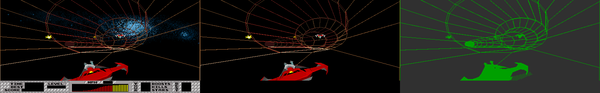
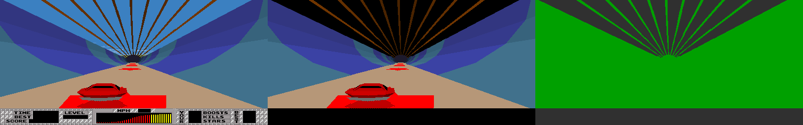
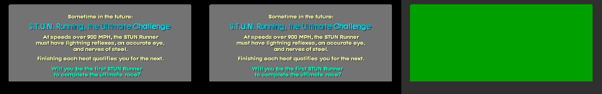

# The SOM display list: from the ADSP to pixels

**Date**: 2026-11-04 (milestone 3, leg M3b). What the ADSP writes into the SOM output buffer each
frame, how it reaches the GSP, and how the GSP turns it into pixels. Addresses are ADSP program
words (PM, 4 hex digits), 68010 addresses (0x......) and GSP bit addresses (8 hex digits). **CODE**
means read off the disassembly (`make dasm`) at the addresses given, **MAME** means a MAME 0.289
run that `make somdump` reproduces confirms it (every run starts from the same empty NVRAM, section
5), **HYP** is a hypothesis. MAME citations are
`file:line` in `~/.local/src/mame/src/mame/atari/` unless another directory is named. The object
ROM records that feed the ADSP are docs/07 (leg M3a); this document starts where a record has
become a projected polygon.

## 0. Summary and the strength of the evidence

- The ADSP builds one list per frame in the SOM bank the 68k does not see: a two-word header, the
  commands (polygons and image quads, back to back), FFFF, a draw-order table with one entry per
  command, ordered by a depth key to within 10h (section 1.5), FFFF (section 1). Every word of 15 captured lists (attract mode and a game, `make
  somdump`) is accounted for by the decoder, and MAME's own write log (the ADSP PC of every
  SOMLATCH write) assigns each field to the instruction section 1 names (MAME).
- When the ADSP signals the list complete (/GINT, 00C1), the 68k flips the bank (ADSP control
  line 3, 0x02C3FA/0x02C408) and copies the list verbatim through the GSP host port into one of
  two GSP command buffers, as command 7000 among its own commands (section 2, MAME).
- The GSP's command interpreter has 16 command codes (section 3); code 7 walks the table and fills
  each polygon span by span through the 2 bpp expander (whose even and odd pixels take the two
  bytes of the colour word), with stipple patterns, outlines and scaled images (section 4).
- **The reference renderer in `tools/displaylist.py` redraws all 15 captured lists and equals
  MAME's frame buffer on every pixel it draws: 1,033,509 pixels over 15 frames, 0 different (and
  224,180 more over three replays whose colour words have two different bytes); and
  every pixel the list changed in MAME's page (page before the list vs after) is one it drew: 0
  missed.** The screen MAME shows a frame later is that page pixel for pixel (122,880 of 122,880
  in all 18 captures). Section 5 says what this proves and what it does not.

## 1. The SOM buffer, word by word

The SOM memory is two banks of 0x2000 words (`m_som_memory`, harddriv.h:386). The ADSP writes
with /SOMCLK (DM 2003, sets the address) and SOMLATCH (DM 2002, stores a word into bank
`m68k_bank ^ 1` and advances; `hdadsp_special_w`, harddriv_m.cpp:803-818); the 68k reads bank
`m68k_bank` at 810000-813FFF (`hd68k_adsp_buffer_r`, harddriv_m.cpp:614) and sets `m68k_bank` with
ADSP control line 3 (`hd68k_adsp_control_w` case 3, harddriv_m.cpp:699-701; 0x02C3FA writes 818006 =
bank 0, 0x02C408 writes 818016 = bank 1).

### 1.1 Layout (CODE, MAME)

| Word | Content | Written by (ADSP) | Read by |
|---|---|---|---|
| 0 | **N**, the address of the last word (an FFFF) | 0034/0035 write 0 at frame start; 00BE writes DM 001E + 1 at the end | 68k 0x02F0C2 (`move.w (A2)+,D2`: the copy length), 0x02F0E2 (`cmpi.w #-1` on word N, else `soft_reset`) |
| 1 | **T**, the address of the FFFF that ends the commands | 0039 writes 0; 00C0 writes DM 0109 | GSP FFF44CA0 (A3 = word 1 + T words: the first table entry) |
| 2 .. T-1 | the commands, back to back (1.2-1.4) | 04EB `emit_polygon`, 0663 `emit_image` | GSP via the table only |
| T | FFFF | 00B5 | nobody: the GSP jumps over it |
| T+1 .. N-1 | the draw order: entry e names the command at word e + 1 | 0828 in `write_draw_order` (080B) | GSP FFF45000-FFF45050 |
| N | FFFF | 082B | GSP FFF45020 (ends the walk); 68k 0x02F0E2 |

DM 001E holds the address of the last word written (1 after the two placeholders, 0032); each
command adds its length (05D7-05DA, 0685-0688), 080B adds the table and its FFFF (082E-0831). A
frame with nothing to draw leaves the empty list 0003 0002 FFFF FFFF: no commands, T = 2, an
empty table (MAME: attract-f4000, frame 5531: `somdump.lua` waits for the next GSP buffer that
holds a SOM list, and none completed in frames 4000-5530; the 68k copies its 3 words,
0x02F0BA). The decoder returns no commands for it and the renderer draws nothing. The
writers in the table are MAME's: `tools/mame/somdump.lua` records the ADSP PC of every SOMLATCH
write (CURPC, the writing instruction), and `tools/displaylist.py` maps each decoded field to
its writers. Over the 18 captures, every word of every field comes from exactly these
instructions and no other (`test_captures_against_mame` asserts this table):

```
header N        PM 00BE      polygon xl/xr/y   PM 0565 0567 056B
header T        PM 00C0      right slope       PM 0580/0582 05A0/05A2 05BA/05BC
separator FFFF  PM 00B5      left slope        PM 0584/0586 05A4/05A6 05BE/05C0
table entry     PM 0828      segment count     PM 0588 05A8 05C2
end FFFF        PM 082B      command end       PM 05D2 05D4 (polygons), 0680 0682 (images)
command word    PM 0515 (polygons), 066A (images)
image x, y      PM 0678, 067A (attract-f2700, -f3000)
```

### 1.2 The command word (CODE; MAME for the cases marked)

Written at 0515 (polygons) or 066A (images) from DM 0036, which the record reader builds (docs/07 section 4, record word 1):
the record's colour (the low 6 bits of its second word, 01A0), lit at 0214 (`((colour << 4) + 10h)
OR shade`, the shade 0-Fh from the normal and the light: 0232 `SR = LSHIFT SI BY 4`, 0234 `AF =
SR0 + AY0` with AY0 = 10h (0233), 0235 `AR = MR1 OR AF`; so the index is `(colour + 1) << 4 |
shade`, and bit 4 is clear for an odd record colour; colours 1Fh and up are not lit and
are stored masked, `colour AND 1Fh` (021A-021F), so a record colour of 20h-3Fh reaches the command
word as 00h-1Fh), 1000h for image records, the type-1 faces (01C9-01CC; docs/07 section 4), and the object's
flags DM 002F (the object list entry's bits 8-11, 0082-0084, docs/07 section 3.1, which calls
them the colour bank: bits 8-9 land in the colour index, bits 10-11 are the fill).

| Bits | Meaning | GSP |
|---|---|---|
| 0-9 | colour index into the colour table FFF71D20 (400h words) | FFF452D0-FFF45320 |
| 10-11 | fill: 0 solid, 1 three pixels in four, 2 one in four, 3 outline (MAME: all four seen) | FFF45150-FFF452A0 |
| 12 | image quad instead of a polygon (MAME: seen in attract mode) | FFF450D0 -> FFF48FC0 |
| 15 | the GSP skips the command (never seen; nothing in 0214/01C9/01CD sets it, HYP) | FFF450A0 |

### 1.3 Polygon command (CODE, MAME)

```
cmd                          0515
xl  xr  y                    0565 0567 056B: the top row; xl the left chain's x, xr the right's
{ right slope (lo, hi)       0580/0582 (or 05A0/05A2, 05BA/05BC)
  left slope  (lo, hi)       0584/0586 (05A4/05A6, 05BE/05C0)
  count }*                   0588 (05A8, 05C2)
FFFF FFFF                    05D2 05D4
```

`emit_polygon` (04EB) clamps every projected coordinate into 0-1FFh (0509-050D), finds the top
vertex (smallest y; on a flat top the left chain starts at the leftmost and the right chain at
the rightmost top vertex, 052B-0544), then walks the two chains down. Each segment ends at the next
vertex of either chain (057A: both, 059D: the left one first, 05B7: the right one first) and
recomputes the slope of the chain that turned: `right_slope` (05DD) and `left_slope` (0607) give
`dx * PM(1036 + dy)`, where PM 1036-1235 (`reciprocal_table`, the loaded record 1036/200; not
the object ROM's 32K-word table in page 1 that `project_vertices` 04B2 reads for 1/z, docs/07
section 5.1) holds
floor(8000h/dy) for dy <= 40h and floor(200000h/dy) above; the ADSP's fractional multiply
(`MR = AR * MY0 (SU)`, 05F1/0601 and 061B/062B) doubles the product and dy > 40h shifts it right
arithmetically by 6 (0602-0603). The slope, a signed 16.16 x step per row, is therefore
`dx * 2*floor(8000h/dy)` for dy <= 40h and `(dx * 2*floor(200000h/dy)) >> 6` above: about
`dx * 10000h / dy`, but with the reciprocal truncated before the multiply, so the low bits
differ whenever 8000h/dy (200000h/dy) is not exact (dx = 1, dy = 3 gives 5554h, not 5555h;
`adsp_slope` in `tools/displaylist.py`). Every one of the 468 distinct slopes in the committed
captures is this formula's for some dx and dy, and 264 of them are not `trunc(dx * 10000h / dy)`
for any (`test_slopes_are_the_adsps_reciprocal_products`; game-f3000's command at word 000D has
000C5524h = 37 * 5554h, dy = 3). The count is dy + 1 (057D-057E); the segment advances count - 1 rows
(section 4.1). A slope is two words, low word first, as the GSP reads a 32-bit field (FFF45510:
`MOVE *A5+,A8,1`).

`emit_polygon` refuses a polygon when DM 001E plus the polygon count DM 002D reaches 1FA4h, or
after 1EAh polygons (04ED-04FB): it sets DM 002E, and the frame loop then stops reading objects
(00AC-00AE) and ends the frame. The bound keeps the list, its table and its two FFFF inside the
2000h-word bank (HYP on the intent).

### 1.4 Image command (CODE; MAME through the redrawing)

```
cmd (bit 12; bits 0-5 the image)   066A
{ x  y }*                          0678 067A: the projected corners, unclamped
FFFF FFFF                          0680 0682
```

Written by `emit_image` (0663) for the records whose type sets DM 0038: type 1 (`record_type_table`
0187 -> 0197), which in the ROM are the 13 faces of objects 335 and 353-363 (docs/07 section 4),
so bits 0-5 are the face's record colour, unlit. The clipper sends them to 068B instead of the
polygon path (0273-0276), which drops the whole image when any corner's z is below C8h (0695-069E,
HYP: a near-plane cull), before 0663 (01D9). 068B runs between `save_index_regs` (064A, called at
068B: I0-I7, M0-M7, L0-L7 into DM 0929-0940) and `restore_index_regs` (0631, called at 069F: the
same registers back from there); the same pair brackets `emit_image` (0663, 0689),
`emit_polygon` (04EB; 0631 at 04F4, 04FA and 05DB) and 00C3-00E6 (CODE). Four corners in every capture. The GSP draws the box at the first point, the second's x - the first's x + 1
pixels wide and the third's y - the second's y + 1 rows high (section 4.4); its far corner is
(p1.x, p2.y) only when p1.y = p0.y.

### 1.5 The draw order (CODE, MAME)

Every command gets a node in a doubly linked list in PM, ordered by a 32-bit key (to within 10h,
below): `insert_depth_node`
(07A2, called at 051D and 0672 before the command's body is written) takes the key from DM 08EA
shifted right arithmetically by DM 0033 (0516-051A, 066B-066F), plus the object's 32-bit bias
DM 0027/0028 from its list entry (07B7-07BB); the first object of the frame (DM 0030 = 0) gets
10000000h instead (07B4-07B5). DM 08EA is a value per polygon, not per object: the face loop
(01A8-01E3, DM 0035 faces per record) calls 01E8 for every face, which clears it (01EA-01EB),
reads the face's normal and first vertex and keeps that vertex's z when it is not negative
(020A-020E); 01B0-01C1 copy each further vertex (x, y, z from DM 010A + its index) and keep the
largest z (01BD-01BF), and 01C3 stores it. So the key is the face's largest vertex z, clamped at
0, scaled by DM 0033 and biased by its object, and the table is ordered command by command, a
painter's ordering of faces, not of objects (CODE). It is not sorted by that key: after storing
the key in the node (07BD/07BE), `insert_depth_node` subtracts 10h from it (07C1-07C5) and every
comparison of the walk (07D5/07D6, 07D9/07DC, 07F5/07F8) uses key - 10h, so a new node goes in
after neighbours whose keys are up to 10h below its own, and each node's key is at most 10h
above the one before it, but a node can lie further above one earlier in the list (CODE).
MAME (`make depthkeys`, `tools/mame/depthkeys.lua`: the list walked from PM 123F to the tail at
every 7th frame of 1000-3000 in attract mode and 1000-6600 in a game, each from an empty state,
when the ADSP waits at 0013-0015): attract, 106 frames, 2446 of 9673 adjacent pairs rise, by at
most 10h, and a node lies up to 4Fh above an earlier one; game, 307 frames, 5927 of 67256 pairs
rise, at most 10h, up to 2Ch over an earlier node. A re-orderer or encoder that sorts by the
stored key does not give the game's order. MAME: neighbouring commands interleave in the
table (game-f3000's first entries are the commands at words 993h, 9A3h, 98Dh, 929h, 943h, 919h),
which one key per object, inserted in order, could not give. A node is six PM words at DM 0956 (+0/+1 key, +2/+3 links, +4 the object number
DM 0108, +5 the value: DM 001E, the command's address - 1). The head is PM 123C, the tail PM 1242.
`write_draw_order` (080B) walks head to tail and writes each node's value (0828), then FFFF.
MAME: in every capture the table is a permutation of the commands (the decoder checks it), so
every command is drawn exactly once; the GSP draws in table order, so the head end is behind (HYP
that larger keys are farther: the redrawing only needs the order, not its meaning).

### 1.6 MAME's LOG_COMMANDS reading (`deferred_adsp_bank_switch`, harddriv_m.cpp:634-682)

| MAME | This document | Verdict |
|---|---|---|
| `end = base + base[0]` | N, the final FFFF; the loop stops before it | right |
| `table = base + 1 + base[1]` | T + 1, the first table entry | right |
| `current = base + 2`, `while (current + 5 < table)` | commands from word 2 | right for polygons: `table` is word T + 1, so a command at word c is read while c + 5 < T + 1 and only a last command shorter than 5 words would be lost (a polygon is at least 6, an image with one point 5 and still read; only an image with no point, 3 words, would be lost: never seen, HYP that none is written) |
| `Cmd @ off = c1 c2-c3 @ c4` | cmd, xl - xr @ y | right (xl, xr on the top row y) |
| `rslope` = first long, `lslope` = second, then `count` | right slope, left slope, count | right; the first long is the right edge's (GSP A6, FFF45540) |
| `rslope == 0xffffffff` ends the command | FFFF FFFF | right (as the GSP, which tests only the first long, FFF45520) |
| every command is a polygon | bit 12 commands are image quads: their (x, y) pairs would print as slopes | **incomplete**: image commands mis-read |
| `c1` printed raw | bits 0-9 colour, 10-11 fill, 12 image, 15 skip | **incomplete** |
| table entries printed raw | entry e = the command at word e + 1 (relative to the list, not to `base + 1`) | **incomplete** (no meaning given) |

## 2. The frame protocol (CODE, MAME)

The game runs 20 lists a second: the GSP's main loop waits until three display interrupts have
passed per list (FFF40ED0-FFF40F90, the header word 12h = 3 in every capture, section 3.1). One
list goes through three such periods: the ADSP builds list k in period n, the 68k copies it into a
GSP buffer in period n + 1, the GSP draws it in period n + 2, the page is shown in n + 3.

Observed order (MAME, `make somdump`, game-f3600's `meta.txt`, frame 3606: write taps on the addresses named,
each event with the writing instruction (CURPC) and the emulated time in seconds):

| Time | Who | What | Instruction |
|---|---|---|---|
| 59.79970 | GSP | flag FFFCFC00 = 0: buffer done | FFF418A0 (`command_buffer_done`) |
| 59.79970 | GSP | HSTCTLL INTOUT set: the 68k's level 3 | FFF41910 |
| 59.79972 | 68k | HSTCTL &= FF7F: INTOUT cleared (FFDB48 = FFFF at 0x02143C) | `h_level3_gsp` 0x021446 |
| 59.79979 | 68k | FFFF ends the other buffer, its flag FFF9FC00 = FFFF: the GSP starts on it | 0x02F218, 0x02F240 |
| 59.80013 | 68k | ADSP control line 3 = 1: the 68k sees the bank the ADSP just finished | 0x02C408 (after `tst.w $ff9bb4` at 0x02C3D6 saw the ADSP done) |
| 59.80042-72 | 68k | /BR = 0 (ADSP held), the parameters DM 1FE6-1FFE (docs/07), DM 1FFF = 0: the frame trigger, /BR = 1 | 0x02E0FA, 0x02E1C2, 0x02E1D4 |
| 59.80073 | ADSP | /SOMCLK = 0 into the other bank: list k + 1 starts | 0034 (after `wait_frame_trigger` 0013-0015) |
| 59.80077 | ADSP | /GINT with DM 1FE3 = 1 (an object asked for a handshake, 0047-0049) | 004C |
| 59.80080-82 | 68k | `h_level2_adsp` -> 0x02E418: /BR = 0, DM 1FE3 = 0, /BR = 1 | 0x02E41C, 0x02E442, 0x02E45E |
| 59.80088 | 68k | host address FFFCFC10: a new command list in the buffer the GSP just finished | 0x02F1AC (`0x02F126`) |
| 59.80217 | 68k | HSTDATA 7000, then words 1..N of the SOM bank (N = 3310) | 0x02F0BA, then 0x02247A (called at 0x02F0D2) |
| 59.83185 | ADSP | /SOMCLK = 0, header, /GINT with DM 1FE3 = 0: list k + 1 complete | 00BB, 00BE, 00C0, 00C1 |
| 59.83191-92 | 68k | `h_level2_adsp`: /BR = 0, FF9BB4 = 1 (the 68k's "ADSP done"), /BR = 1 | 0x02E41C, 0x02E44A (CODE: not a tapped write), 0x02E45E |
| 59.84953 | GSP | flag FFF9FC00 = 0, INTOUT; the cycle repeats with the buffers swapped | FFF418A0, FFF41910 |

The 68k's frame routine is 0x02C372: it waits for FF9BB4 (0x02C3D6), flips the bank by the
parity FF9BB2 (0x02C3F2-0x02C40E), starts the ADSP's next frame (0x02E064 or 0x02DD9E at 0x02C424
/0x02C438), begins a GSP command list (0x02F126 at 0x02C454), adds its own commands, copies the
SOM list (`jsr $2f0ae` with 810000 at 0x02C5EA-0x02C5F0) and returns; the end of the list (0x02F1BE)
waits for the GSP's level-3 interrupt (0x02FC60 polls FFDB48) and makes the buffer ready. The two
buffers' flag and list addresses are the table at 0x04A88C (FFF9FC00, FFF9FC10, FFFCFC00,
FFFCFC10), selected by FFDB3A (0x02F126-0x02F14E). If a buffer's flag is still set the 68k waits
once more and then reports "OUT OF SYNC" (0x02F164-0x02F198, `soft_reset`); a copied list whose
word N is not FFFF resets the game (0x02F0E2-0x02F0E8).

The copy is word for word: in every capture the bank rebuilt from the ADSP's writes equals what
the 68k reads at 810000 at the copy, and the GSP buffer's code-7 command holds the same list
(`make somdump`; `test_captures_against_mame`). HYP from docs/06 confirmed: the 68k copies the list
through the host port; it does not interpret it.

## 3. The GSP command set (CODE; MAME for the lengths of the codes seen)

### 3.1 The command buffer

Two buffers, flag words FFF9FC00 and FFFCFC00, lists from FFF9FC10 and FFFCFC10 (`poll_command_buffers`
FFF41010). The list starts with a header block that `process_command_buffer` (FFF411A0) skips by
the 16-bit word at FFF77F50 (FFF411D0-FFF41200): 440h bits, 44h words, in every capture (who
writes FFF77F50 is open, section 6). `read_list_header` (FFF4D940) reads three of its words: 11h
-> FFF77E60 (flags: bit 3 every polygon as an outline, FFF45130; bit 4 no size limits for image
quads, FFF49460; bit 5 outlines without right edges, FFF45B50; bit 2 a debug overlay, FFF44890),
12h -> FFF77E80 (the display frames per list, 3), 13h -> FFF77E70. The rest of the header is M5d.

`run_command_list` (FFF46E30) sets B4 = page - A000h, the window (0, 28h)-(1FFh, 117h) and
CONTROL = C0h (window clipping, W = 3), then reads a command word, dispatches on its top nibble
through `command_table` (FFF470E0, 16 longs) and loops (FFF46F90-FFF47040). Field 0 starts
every list sign-extended (`read_list_header` leaves ST FE0 = 1, FFF4D990) until a handler resets
it. 1, 2, 3, 7, A, B and D have no SETF of field 0 and keep the mode the commands before them
left, but only some of their reads depend on it: 3 and D read 32-bit longs (`MOVE *A5+,An,1`:
FFF47A20/FFF47A40, FFF4A630/FFF4A6D0); 2 keeps the low 16 bits of its x reads (`MOVY` over them
at FFF480C0, FFF48100) and shifts its y reads left by 16; the polygon code of 7 does the same
(section 4.4). What can depend on FE0 is the image quad's corners (command 1 and 7's bit-12
commands, section 4.4) and A's step word (`MOVE *A5+,A6,0` at FFF49E10, added as 32 bits at
FFF49F10).

### 3.2 The codes

Lengths in words, the command word included. "Seen" = present in the 18 captured buffers, whose
commands the decoder walks to the end command with no word left over (MAME); the others are CODE.

| Code | Handler | Operands | Length | Seen |
|---|---|---|---|---|
| 0, F | FFF47050 `end_command_list` | none: leaves the list | 1 | F |
| E1-E3 | FFF472E0 `cmd_E` -> FFF47390 -> FFF47050 | none; reaches `end_command_list` one call deeper, with an unbalanced stack (below) | 1 | |
| 1 | FFF48FC0 `cmd_1_image_quad` | image = low 6 bits; 4 points; longs to FFFFFFFF | 7 + 2k | |
| 2 | FFF47E20 `cmd_2_line` | colour = low byte; x0 y0 x1 y1 (PSIZE 8) | 5 | |
| 3 | FFF47900 `cmd_3_rectangle` | colour = low byte; (y, x) long, (dy, dx) long; FILL in the 2 bpp window | 5 | yes |
| 4 | FFF48650 `cmd_4_text` | colour = low byte; font, x, y (FFFF: previous); NUL-terminated string padded to a word | 4 + ceil((len + 1) / 2) | yes |
| 5 | FFF47AF0 `cmd_5_window` | x0 y0 x1 y1, clamped to x <= 1FFh, 28h <= y <= 117h | 5 | yes |
| 6 | FFF477C0 `cmd_6` | low byte; words to an FFFF (FFF595B0 consumes them: M5d) | to FFFF | |
| 7 | FFF44BF0 `cmd_7_som_list` | the SOM list from its word 1 (section 1) | 1 + N | yes |
| 8 | FFF489E0 `cmd_8_image` | three words, one long (FFF58950: M5d) | 6 | yes |
| 9 | FFF48C20 `cmd_9_palette` | start = low byte; count n; 3 words per two entries, 2 for an odd last | 2 + 3(n div 2) + 2(n mod 2) | yes |
| A | FFF49AF0 `cmd_A_dissolve` | a step word | 2 | |
| B | FFF4A040 `cmd_B` | none (FFF52060: M5d) | 1 | |
| C | FFF4A420 `cmd_C_colour_table` | quarter = low 2 bits; start; count; count words into FFF71D20 + quarter * 1000h bits | 3 + count | |
| D | FFF4A5C0 `cmd_D_fb_entry` | entry = low 2 bits; two longs into FFF71C20 | 5 | yes |
| E0 | FFF4A6F0 `cmd_E0_image_table` | start <= 3Fh; count; count longs into FFF78150 | 3 + 2 count | |

Codes 0 and F reach FFF47050 straight from the dispatcher's `CALL A0` (FFF47030), and its `ADDK
20h,SP` drops that one return address. E1-E3 go through `cmd_E`'s own `CALL A0` (FFF47370) into the
sub-table at FFF47390, so they arrive with two return addresses on the stack: `ADDK 20h,SP` drops
cmd_E's, `MMFM SP,B8` (FFF47090) pops the dispatcher's into B8, `MMFM SP,A0-A14` (FFF470B0) restores
the registers shifted by one long and `RETS` (FFF470D0) returns to a saved register's value. They
do not leave the list the way 0 and F do (HYP: never used; the decoder rejects them). Code C
leaves the list cleanly when start + count is above 100h (`JRHI FFF47050` at FFF4A550, one call
deep as 0 and F). E0 out of range restarts the GSP program instead: `JAHI FFF40000` (`gsp_main`)
when start > 3Fh (FFF4A730) or start + count > 40h (FFF4A7C0). The decoder rejects all of these.

The order of the commands is the 68k's, frame by frame, not a rule of the protocol. In the 18
captures of section 5 a buffer starts D, one to three 9, 5; then, before the SOM list, 3 and two 8
(attract-f1200 to -f2100, game-f2400, -f3600, -f4800) or nothing; then 7, D, 5 and the dashboard
text (4, with a 3 among them in all but attract-f2700 and -f3000), and F. But the two 8 can also come right after the list, drawn over the 3D
scene (game-f1000, frame 1047, and game-f1100: `D 9 5 7 8 8 D 5 4 ...`), and palette loads 9 can follow the text
(game-f1000 and attract-f4000: `... 4 9 9 F`; game-f4200: `... 4 9 F`). The colour table (C) and the image table (E0)
were loaded before the captured frames (HYP: at mode changes).

### 3.3 Command 7 (CODE, MAME)

`cmd_7_som_list` (FFF44BF0): A5 = the list's word 1, A1 = A5 (the base of the table entries), A3 =
A5 + 10h * T (FFF44CA0-FFF44CC0). `som_next_entry` (FFF45000): A5 = *A3++; FFFF ends the list
(CMPXY with FFFFFFFF, FFF45020) and the dispatcher continues after the list (FFF44D10: A5 = A3);
else A5 = A1 + 10h * entry (FFF45040-FFF45050: the command at word 1 + entry) and
`som_draw_command` (FFF45090) draws it: bit 15 returns (FFF450A0), bit 12 goes to the image quad
(FFF450D0 -> FFF44D60 -> FFF48FC0), otherwise a polygon (section 4).

## 4. The rasteriser (CODE, MAME)

### 4.1 Screen, page and window

The frame buffer is 8 bits per pixel in VRAM, two pages of 512 x 240 bytes at VRAM 000000 and
01E000. The polygons are drawn through the **2 bpp expander** window at GSP 02000000 (PSIZE 2,
DPTCH 400h bits per row), where pixel n of a page is VRAM byte n (`hdgsp_vram_2bpp_w`,
harddriv_v.cpp:300: each 2-bit pixel whose low bit is set writes one byte of
`gsp_control_lo[0]`). B4 holds the page being drawn, 02000000 or 0203C000, and flips after each
list (FFF412F0-FFF41690); `run_command_list` subtracts A000h (40 rows) from it (FFF46E70), so GSP
y 28h is the page's row 0: the coordinates the ADSP writes are x 0-1FFh, y 28h-117h on screen.
MAME: the screen is 512 x 240 (the TMS34010 sets the visible area from its own timing registers,
tms34010.cpp:1060-1080, replacing harddriv.cpp:1869's initial 228 lines), and the snapshot one
frame after a list equals the page it drew, row 0 at the top, through palette bank 0, in all 18
captures (122,880 of 122,880 pixels each).

The clip window is the hardware's (CONTROL W = 3: FILL and LINE skip what falls outside WSTART-
WEND, `apply_window` and `line` in `src/devices/cpu/tms34010/34010gfx.hxx`). Command 5 sets it;
in every capture the SOM list is drawn inside (0, 28h)-(1FFh, F7h), rows 0-207, which leaves the
dashboard rows alone. The ADSP's own clamp (0-1FFh, 0509) is the only clipping of the polygon
coordinates themselves. The clipping before projection (0271: images through 068B, section 1.4;
polygons from 0278 on) is not decoded here, nor in docs/07, which leaves the clipper to this
document (docs/07's introduction): section 6, question 7.

### 4.2 A polygon (FFF45090-FFF45630)

```
B0 = (y, xl)            left edge, packed (y in the high 16 bits)      FFF453D0
A6 = (y, xr) + (1, 1)   right edge, exclusive, one row down            FFF453E0
A0 = A4 = 80000000h     both fractions start at one half                FFF453F0-FFF45410
rows = 1
loop:
    fill the row y from B0.x to A6.x - 1 (FILL XY, DYDX = A6 - B0)    FFF454A0-FFF454E0
        skipped with the pattern unrotated if xl > xr + 1 (SUBXY V)    FFF454D0
    rotate the pattern left by 4                                       FFF454F0
    if --rows == 0: read the next segment (FFFFFFFF: done)             FFF45500-FFF45620
        A7 = right slope << 16, A8 = (right slope >> 16) + 10000h
        A9 = left slope << 16,  B1 = (left slope >> 16) + 10000h
        rows = count, then --rows
    step: A0 += A9, B0 += B1 + carry; A4 += A7, A6 += A8 + carry      FFF45460-FFF45490
```

The slope is signed 16.16 x per row. The integer part plus 10000h is added to the packed (y, x)
as one 32-bit number, so the same add steps y by one and x by the integer part; the fraction
accumulates in A0/A4 from one half (round to nearest at the start). The first segment's count
includes the top row, which is filled before any step: a polygon covers 1 + sum(count - 1) rows.
The right edge is exclusive (A6 = xr + 1), so a row spans xl..xr inclusive.

### 4.3 Colour, dithering and fills

The colour is the word at FFF71D20 + 10h * (command & 3FFh), written to F4000000
(`gsp_control_lo[0]`, FFF452D0-FFF45330). The expander replicates it as `color | color << 16`
and writes byte i of that long to pixel i of each group of four (harddriv_v.cpp:300-318, the
mask table at :32-56): **even pixels get the low byte, odd pixels the high byte**, so a colour
word could be a two-index dither (CODE, the MAME source). The game's own table does not use it:
in all 15 captures every one of the 400h words has equal bytes, so those comparisons cannot tell
this rule from one byte everywhere. The MAME evidence is the three `dither-f*` captures of
section 5, a replay of attract mode in which `somdump.lua` (SOM_DITHER=1) rewrites every word
as lo | (lo ^ 80h) << 8 each frame: there the redrawing matches MAME's page on every pixel, fills
and outlines, even and odd (MAME).

The pattern COLOR1 (B9) decides which 2-bit pixels are written: FFFFFFFF (solid), 15151515h
(01 01 01 00: three pixels in four; also for colour byte 4 with fill 0 or 2, FFF45230-FFF45290),
01010101h (one in four). It is rotated left by 4y bits at the top row (FFF45370-FFF45390) and by 4
after each row, so the stipple shifts two pixels per row: pixel x of a row is written when bit
(2x mod 16) of the rotated pattern is set (MAME's FILL takes COLOR1's low 16 bits for every word,
34010gfx.hxx:1797-1960; the patterns repeat every 8 bits, so the real chip's alternating halves
would give the same result). The fill bits come only from the object: the record reader stores
the record colour masked to 6 bits (019C-01A0), lighting builds bits 0-8 (0214-0236), and bits 8-11
are DM 002F, the object list entry's bits 8-11 (0082-0084, docs/07 section 3.1), ORed in at 01CD-01CF, so an
object is filled one way in all its faces (CODE). In the game captures of section 5 none to 5
faces use fill 2, all colour 14h (a shadow under the player's ship, HYP); at frame 6303 of the same
game run (`make somdump SOM_GAME=1000,2400,3000,3600,4200,4800,6300`, game-f6300: 109 25% and 219
solid commands, redrawn equal on all 106496 pixels) the 109 fill-2 faces have 21 colours (13h-17h,
85h-8Ch, B9h, E3h-ECh) and the snapshot shows the player's ship drawn stippled (MAME). Some 300
frames later the same ship is drawn with fill 1: game-f6600 (frame 6605, in the default
`SOM_GAME`) has 105 fill-1 faces in 21 colours of the same ranges, none with colour byte 4 (snap_1 shows
the ship stippled again, more densely), and
the redrawing with 15151515h equals MAME's page on all 106494 pixels; with the solid pattern in its
place 1295 of them differ (MAME). Which of fill 1 or 2 the ship gets is the 68k's choice (HYP: the
entity's state; section 6, question 6). Colour byte 4 occurs too: game-f1100 (frame 1104) has 17 fill-0 polygons
of colour 004h and 204h, redrawn as 75% equal to MAME on all 106496 pixels; drawn solid, 1087
differ (MAME). Both are the unlit record colour 24h masked to 04h (021E-021F), 204h with bit 9
from the object's flags (01CD-01CF; HYP: no lit colour can end in 04h but 104h, record colour 0Fh
at shade 4).

### 4.4 Outlines and image quads

**Outline** (fill 3, or FFF77E60 bit 3 whatever the fill, colour byte 4 included: `BTST 3h,A13`
at FFF45130 branches before the fill is read at FFF45150; `draw_outline` FFF45800): the top row, then for each
segment of count n > 1 both edges as LINE 0 Bresenham lines from the current vertex by (dx, n - 1),
dx = the integer part of slope * (n - 1) (MPYS with a 12-bit field, FFF45A80-FFF45AF0, no
rounding), then the bottom row (FFF45BF0). `draw_edge_line` (FFF45C60) sets up LINE 0 (decision
2 minor - major, a diagonal step when it is >= 0). MAME's LINE writes one 2-bit pixel, COLOR1's
low pixel (`line`, 34010gfx.hxx:21-60; the pattern is all ones here), through the 2 bpp expander:
nothing between FFF45C60 and FFF45DD0 changes PSIZE, so the expander stores byte x & 3 of
`color | color << 16`, and a line pixel gets the colour word's byte for its parity, low at even
x, high at odd x, as a fill does (MAME: the `dither-f*` captures, section 5). The attract mode's wireframe tunnel
(attract-f2100, 102 outlines; also attract-f1200 and -f1800) is drawn this way (MAME, redrawn
exactly).

**Image quad** (bit 12; `cmd_1_image_quad` FFF48FC0, also top-level command 1): PSIZE 8, CONTROL
E0h (pixel 0 transparent), the image (command & 3Fh) from the table FFF78150 (loaded by command
E0): height, width, then pixels from 60h bits on. The box starts at point 0 (B2 = (p0.y, p0.x),
FFF49350-FFF49370); it is p1.x - p0.x + 1 wide (`SUB A0,A1` FFF493D0, `INC A1` FFF49420) and
p2.y - p1.y + 1 high (A0 = p1.y at FFF494E0, A2 = p2.y at FFF49500, `SUB A0,A2` FFF49570, `INC A2`
FFF495C0; the rows run from p0.y, `DSJS A2` at FFF499C0), so its far corner is
(p1.x, p0.y + p2.y - p1.y), which is (p1.x, p2.y) only when p1.y = p0.y. Each axis is scaled by a
16.16 step (DIVU: image size << 16 / box size, FFF496E0, FFF49760) whose fraction accumulator
starts at one step, not zero (FFF49710, FFF49790). The corners are read with field 0
(`MOVE *A5+,An,0`, 16 bits), and the handler has no SETF of its own: whether they are sign- or
zero-extended is ST FE0 as the commands before it left it. `read_list_header` sets FE0 = 1 before
every list (`SETF 10h,1,0` at FFF4D990, no SETF before its RETS at FFF4DAB0; called at FFF41270,
then `run_command_list` at FFF412A0), so each list starts sign-extended. Handlers 4 (FFF48900),
5 (FFF47B20), 6 (FFF47890), 8 (FFF48C00), 9 (FFF48C30), C (FFF4A420) and E0 (FFF4A6F0) run
`SETF 10h,0,0` and return with it; 1, 2, 3, 7, A, B (whose CALLA FFF52060 reaches a bare RETS)
and D have no SETF of field 0 and keep the mode, and nothing in the SOM loop (FFF44BF0-FFF45FB0)
sets it (CODE). In every captured buffer the 7 follows a 9 and a 5 (section 3.2), so its image
quads read their corners zero-extended: that is the 68k's command order, not a property of the
handler. MAME (`make fieldext`, `tools/mame/fieldext.lua`, attract frames 0-3100 from an empty
state): FE0 = 1 at all 307 list starts (FFF46E30) and 0 at none; at command 7 (FFF44BF0) 0 at all
287 and 1 at none; at the corner read FFF49380 0 at all 83 hits, last ST 00200010; at the SOM
command loop FFF45010 0 at all 2274Dh. (The SOM loop zero-extends its table entries itself,
`ZEXT A5,0` at FFF45010, and its polygons do not depend on FE0: the x reads keep only their low
16 bits, MOVY at FFF453B0-FFF453D0, y is shifted left by 16, FFF453A0, and a row count would
need 8000h rows to differ.)
`field0_sign_extended` in `tools/displaylist.py` follows the buffer's commands and the renderer
reads the corners accordingly. Zero-extended, no corner is negative; sign-extended, a corner of
8000h or more is. Boxes are rejected
(FFF49230-FFF49650) when the image is missing (FFF49230), point 0's x >= 200h (FFF49280) or its
y >= 117h (FFF492F0) (signed tests, `CMPI` then `JRN`: zero-extended, a p0.x or p0.y of 8000h or
more is rejected here; sign-extended, it passes and the box starts left of or above the window,
which clips it), point 1's x is negative (the `JRNN` after the read at FFF49390 skips the
rejection whenever the corners are zero-extended, so a p1.x of 8000h or more is then a very wide
box that only the 15Eh limit rejects, drawn with bit 4, clipped by the window) or left of point
0's (`SUB A0,A1`, FFF493D0),
point 2's y is
below 28h (`CMPI 28h,A2`, FFF49510) or above point 1's y (`SUB A0,A2` with A0 = point 1's y
from FFF494E0, FFF49570; the height is p2.y - p1.y + 1), or (without FFF77E60 bit 4) the box is
15Eh wide or C8h high or more (FFF49480, FFF495F0). The text panel of the attract
mode's story screen is one such quad (attract-f3000); attract-f2700 has a small one, scaled down. The images are the 68k's
packed images (pairs U-V, M5d); `somdump.lua` dumps them for the redrawing, never committed.

### 4.5 What is not in the SOM list

Everything 2D comes from the 68k's own commands in the same buffer (section 3.2): the sky and
ground rectangles (3), backgrounds and the dashboard (8, D: images, M5d; an 8 after the list is
drawn over the 3D scene, game-f1000), the window (5), palette
loads (9), the dashboard text and digits (4). The SOM list carries only the ADSP's polygons and
the image quads that are part of the 3D scene (sprites placed in the world, the text panel): the
type-1 faces of objects 335 and 353-363 (docs/07 section 4), drawn as images (section 4.4), not
as flat unlit panels (M3a's hypothesis, which docs/07 now replaces with a pointer here).

## 5. The reference renderer and what it proves

`tools/displaylist.py` implements section 4 instruction by instruction: the packed (y, x)
arithmetic with carries, the half-pixel start, the V test that skips a row and its pattern
rotation, the window, the expander's even/odd bytes (for FILL and LINE alike), the three patterns
and their rotation, LINE 0 for outlines, the skip of a bit-15 command (FFF450A0), the header word
FFF77E60's bits 3 (every polygon an outline), 4 (no image size limits) and 5 (no right edges), and
the image quad's scaling and checks, with its corners sign- or zero-extended as the buffer's
commands before the 7 leave field 0 (section 4.4).
`make somdump` captures, for each chosen frame:
the page when the GSP reads the 7000 (before the list) and when it reads the word after the list
(GSP read taps on those two command-buffer words; both reads are the dispatcher's `MOVE *A5+,A4,0`
at FFF46F90, the CURPC that `meta.txt` records as `fb_som_pc`), the colour and image
tables at that moment, and the window the buffer set. The renderer draws the list on an empty
page and is compared with MAME's page after the list:

| Capture | Frame | List words | Commands | Pixels drawn | Equal | Changed by the list | Missed | Snapshot = page |
|---|---|---|---|---|---|---|---|---|
| attract-f1200 | 1206 | 6192 | 238 solid, 106 outline | 106496 | 106496 | 106496 | 0 | 122880 |
| attract-f1500 | 1503 | 5168 | 287 solid, 5 25% | 44083 | 44083 | 44083 | 0 | 122880 |
| attract-f1800 | 1808 | 6721 | 315 solid, 5 25%, 36 outline | 106460 | 106460 | 106379 | 0 | 122880 |
| attract-f2100 | 2105 | 5908 | 215 solid, 5 25%, 102 outline | 11224 | 11224 | 11224 | 0 | 122880 |
| attract-f2700 | 2705 | 94 | 4 solid, 1 image | 85 | 85 | 85 | 0 | 122880 |
| attract-f3000 | 3024 | 67 | 3 solid, 1 image | 91794 | 91794 | 91794 | 0 | 122880 |
| attract-f4000 | 5531 | 4 | none (an empty list) | 0 | 0 | 0 | 0 | 122880 |
| game-f1000 | 1047 | 6885 | 358 solid, 5 25% | 106493 | 106493 | 106493 | 0 | 122880 |
| game-f1100 | 1104 | 5852 | 344 solid (17 colour byte 4) | 106496 | 106496 | 106496 | 0 | 122880 |
| game-f2400 | 2406 | 4421 | 233 solid, 3 25% | 82350 | 82350 | 82350 | 0 | 122880 |
| game-f3000 | 3005 | 2616 | 128 solid, 3 25% | 106496 | 106496 | 106496 | 0 | 122880 |
| game-f3600 | 3606 | 3311 | 178 solid, 3 25% | 60332 | 60332 | 60332 | 0 | 122880 |
| game-f4200 | 4232 | 4973 | 257 solid, 5 25% | 59993 | 59993 | 59993 | 0 | 122880 |
| game-f4800 | 4806 | 4770 | 243 solid, 5 25% | 44713 | 44713 | 44713 | 0 | 122880 |
| game-f6600 | 6605 | 4872 | 134 solid, 105 75%, 5 25% | 106494 | 106494 | 106494 | 0 | 122880 |
| dither-f1200 | 1206 | 6192 | as attract-f1200 | 106496 | 106496 | 106496 | 0 | 122880 |
| dither-f1800 | 1808 | 6721 | as attract-f1800 | 106460 | 106460 | 106103 | 0 | 122880 |
| dither-f2100 | 2105 | 5908 | as attract-f2100 | 11224 | 11224 | 11224 | 0 | 122880 |

"Pixels drawn" counts the pixels the renderer writes (last writer wins), "Equal" those equal to
MAME's page after the list, "Changed" the pixels that differ between MAME's page before and after
the list, "Missed" the changed pixels the renderer did not draw. The three `dither-f*` rows are
a third MAME run of `make somdump`: attract mode again from the same empty state, with
`SOM_DITHER=1`, which rewrites every colour word as lo | (lo ^ 80h) << 8 each frame (the GSP only
reads the table): the lists are byte-identical to attract-f1200, -f1800 and -f2100's, but every
polygon now has two different bytes for its even and odd pixels. In the 15 game-table captures
every colour word has equal bytes, so only these three test which byte a pixel gets; in them the
redrawing is equal on every pixel, fills and outlines (dither-f2100: 102 outlines), even x low
byte and odd x high byte (`test_captures_against_mame` asserts all four cases occur). "Snapshot = page" compares the
screen snapshot one frame later with the final page through palette bank 0. Pictures (MAME's page
| the redrawing | green equal, red different, grey not drawn): 



**What this proves.** For these 15 frames the format of section 1 is complete (no word
unexplained, the table a permutation), and the description of section 4 reproduces MAME's TMS34010
pixel for pixel on every pixel the list touches, including the stipple phase, the window, the
outlines' Bresenham lines, the 75% pattern (game-f6600), colour byte 4 under fill 0 drawn as 75%
(game-f1100) and the scaled image; nothing the list changed is missing from the
redrawing. The expander's even/odd bytes, for fills and for outlines, rest on the three
`dither-f*` captures with their modified table: the game's own table gives no two-byte colour in
any capture, so no frame the game draws shows a dither. **What it does not prove.** MAME is the oracle, not the board: where
MAME's TMS34010 simplifies (FILL's COLOR1 halves, LINE's pixel colour) the redrawing follows MAME.
Rows skipped by the V test do occur, but not in a way that shows the rule they exist for, the
pattern left unrotated. MAME skips them (`make vskip`: `tools/mame/vskip.lua` breaks at FFF454C0
and, on V, at FFF454D0, from an empty state: `skipped=1AF tests=DAEB4` in attract frames 0-1700,
`skipped=790 tests=4BFFBD` in a game to frame 6600, hex), 2356 of the 2367 with B9 = FFFFFFFF, a
solid fill. In the captures they are in solid fills (game-f3000, command @07AB, rows 74h-77h;
game-f6600, @0032 and @0072, 11 rows; game-f1100 @1562; game-f4200 @039F), in outlines' top or
bottom rows (FFF459F0/FFF45C30; attract-f1200 @0551, attract-f2100 @0E5A) and, for 6 of the 11
stippled rows MAME logged, captured by `make somdump SOM_ATTRACT=1066 SOM_GAME=5058,5340` (frames
1071, 5062, 5345; MAME's log at 1070, 5061 and 5344 names the same rows, B9h, B7h and 93h-94h),
in the polygon's last row or before rows of width 0 only. Those captures redraw equal to MAME, and
redrawn with the pattern rotated on every skipped row, every capture gives the same pixels. So
the no-rotation rule is CODE plus the CI test only (the other five stippled skips, at frames 5065,
5347, 6305 and 6592, were not captured). Bit 15, FFF77E60 bits 3
and 5 (word 11h is 0000 or 0010 in every capture), colour byte 4 under fill 2 and commands 1, 2, 6, A, B, C and E0 do not
occur in the captures: their description is CODE only (all but the commands have synthetic CI
tests of the renderer, which pin the code reading, not MAME). The colour table, the palette and the images are
inputs taken from MAME's memory; how they are loaded is M5d. "Changed" equals "drawn" in 14 of the 15
captures; in attract-f1800 the list writes 81 pixels with the value they already had (drawn and
equal, not changed). A pixel written so is invisible to the "missed" test.

The captures are reproducible: `make somdump` removes `build/mame/somstate` and starts each MAME
run (attract, the game, then attract with the modified colour table) with that empty directory as its NVRAM and cfg, so the game boots
from the set's own 200e/210e. Attract mode depends on the NVRAM's history (a run from a previous
run's NVRAM shows different scenes at the same frames), so the frames above hold only from that
state; two runs from it give byte-identical captures.

CI cannot run MAME: it decodes the three lists committed under `artifacts/display-list/`
(attract-f2100, attract-f3000, game-f3000; runtime SOM memory, 11.5 KB, 134 bytes and 5.2 KB) and
redraws their polygons with a synthetic colour table against checksums recorded when the same
redrawing matched MAME, the `dither-f*` captures included, whose colour words have two bytes as
the synthetic table's do (`expected.json`, written by `tools/displaylist.py CAPTURE --export NAME`).
The colour table and the images are not committed (the game's data), so CI does not redraw
attract-f3000's image quad: the test asserts it is the one command left undrawn. The image
scaler (16.16 steps, the accumulators' start at one step, the transparent pixel, every rejection
of section 4.4, the box limits with and without FFF77E60 bit 4), the stipple phase at an odd y,
a row skipped by the V test (no rotation) against an empty row (rotated), colour byte 4 as 75%,
a bit-15 command left undrawn beside a drawn one, FFF77E60 bit 3 (every fill an outline) and bit 5
(outlines without right edges), the outline's odd-x pixels taking the high byte and the clamp of a
command-5 window run in CI on synthetic inputs (`tools/test_displaylist.py`).

## 6. Open questions

1. Who writes FFF77F50 (440h in every capture) and what the rest of the 44h-word header holds (M5d).
2. Commands 6, 8, B and D's targets (FFF595B0, FFF58950, FFF52060, the entries at FFF71C20) and
   the palette packing of command 9 (M5d).
3. The meaning of the depth key's direction and of DM 0033 (the object's shift); docs/07 does not
   cover them either.
4. The object handshake: 0047-004F raise /GINT mid-frame when an object entry has bit 14 set; the
   68k answers at 0x02E418 and, with FF9C74 set, defers it to 0x02E3E0, which calls 0x02DFFE before
   releasing the ADSP (HYP: the 68k recomputes something per object; M5).
5. ADSP control line 4, cleared and set around every ADSP access (0x02E100/0x02E1CE in the frame
   start, 0x02E422/0x02E458 in `h_level2_adsp`; the /BR writes beside them are 0x02E0FA/0x02E1D4
   and 0x02E41C/0x02E45E), and line 2, set once at the ADSP restart (0x02C248) and at 0x02142C:
   no function in MAME (docs/06 section 9).
6. Bit 15 of the command word: whether anything produces it. Nothing in 019C-01D0 or 0214-0236
   sets it (HYP that it is never produced). The 75% fill and colour byte 4 are produced and
   redrawn equal to MAME (section 4.3: game-f6600, game-f1100); what stays open is which state of
   the 68k's entity selects fill 1 or 2: the fill is the object entry's bits 10-11 (0082-0084,
   01CD-01CF), which the 68k builds from the entity's +38h bits 3-4 (0x02E274-0x02E276, docs/07
   section 3.1), and the ship is drawn with fill 2 at frame 6303 and fill 1 at 6605 of the same
   game (M5).
7. The clipper (0271-04B1): the polygon path from 0278 (the edge moves at 02C8, 031F, 0385, 03EB
   and 0452 that `project_vertices` 04B2 follows). docs/07 leaves the clipper to docs/08 and
   docs/08 does not decode it. (064A and 0631 around the image cull at 068B are answered: they
   save and restore the index registers, section 1.4.)
